# wealthsimple Design System

You are building UI for **wealthsimple**. Dark-themed, warm palette, sans-serif typography (tiempos), compact density on a 4px grid, expressive motion.

## Visual Reference

**IMPORTANT**: Study ALL screenshots below before writing any UI. Match colors, typography, spacing, layout, and motion exactly as shown.

### Homepage

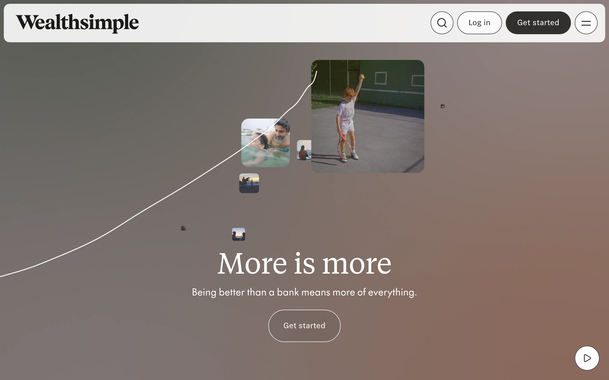

### Scroll Journey (Cinematic Visual States)

> These screenshots capture the website at different scroll depths. The design changes dramatically as you scroll — each frame shows a different cinematic state. Replicate these exact visual transitions.

#### 0% — Hero / Above the fold

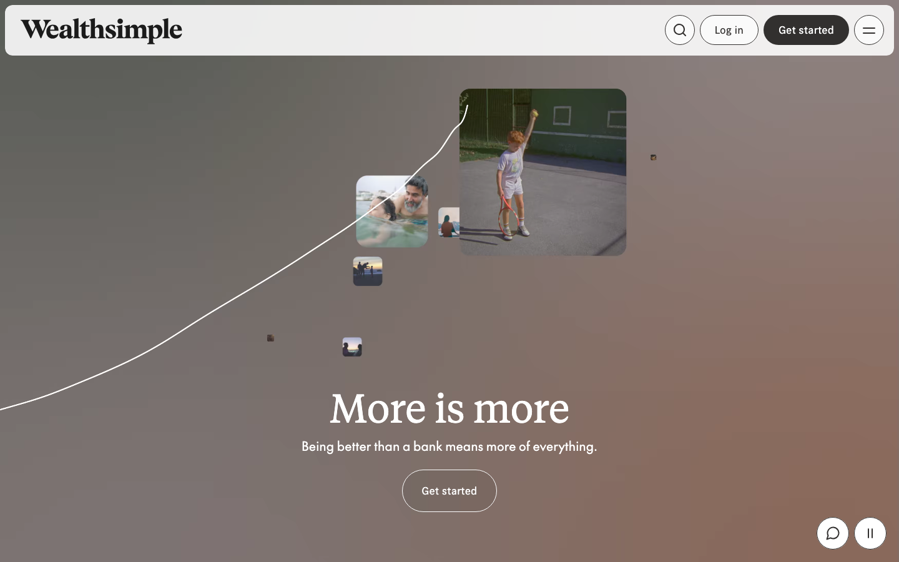

#### 17% — Mid-page at 17% scroll

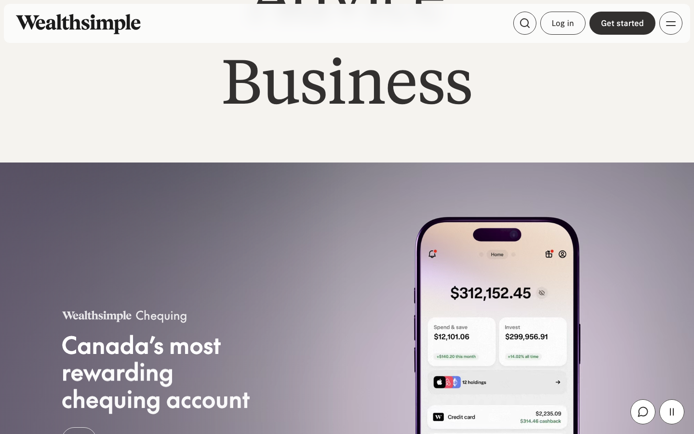

#### 33% — Mid-page at 33% scroll

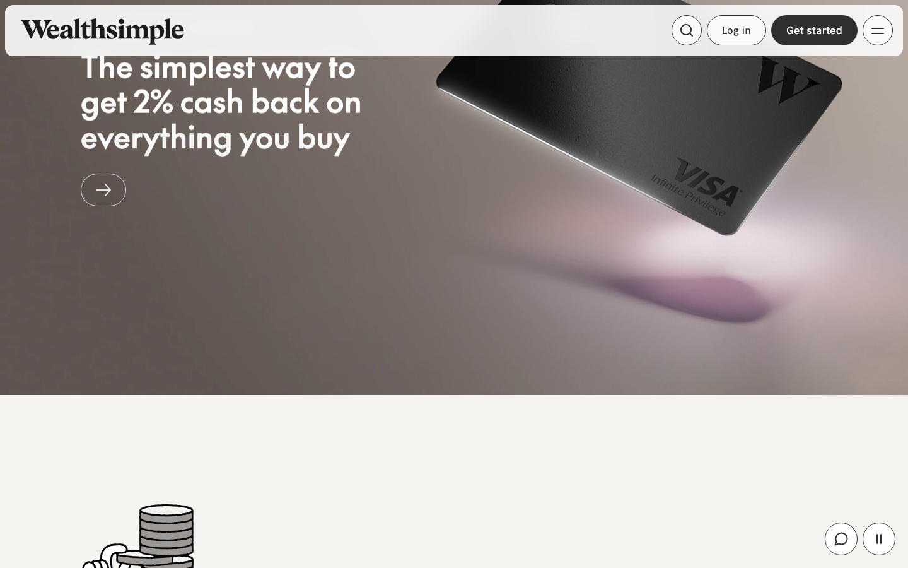

#### 50% — Mid-page at 50% scroll

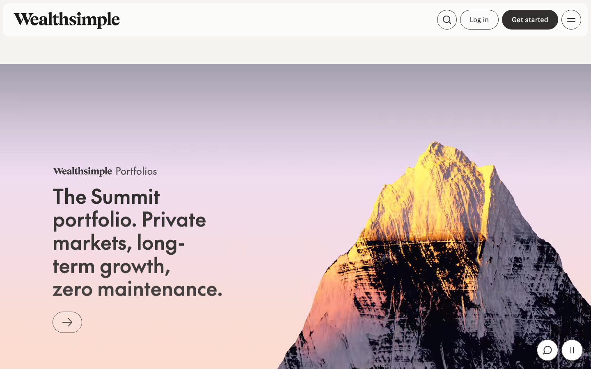

#### 67% — Mid-page at 67% scroll

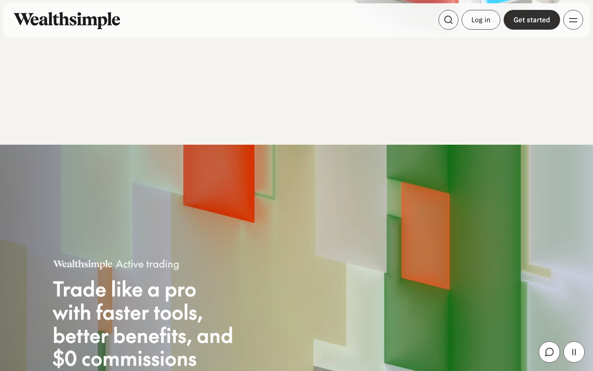

#### 83% — Mid-page at 83% scroll

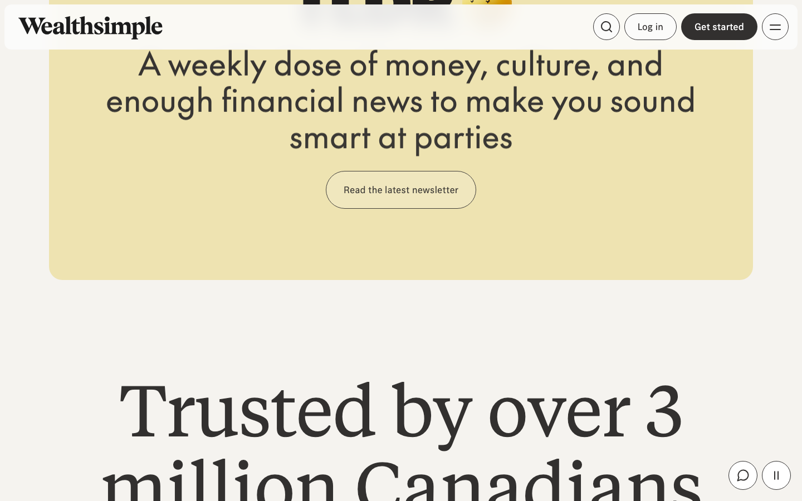

#### 100% — Footer / End of page

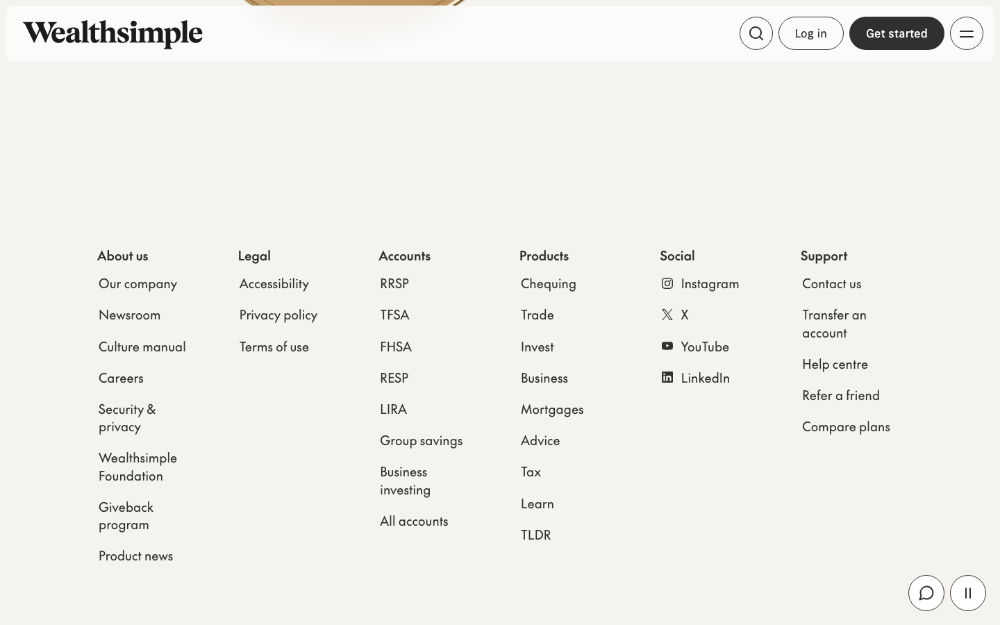

### Video Backgrounds (First Frames)


> Read `references/DESIGN.md` for full token details. Read `references/ANIMATIONS.md` for motion specs. Read `references/LAYOUT.md` for layout structure. Read `references/COMPONENTS.md` for component patterns.

## Ultra Reference Files

This package includes extended documentation. **Read these files before implementing:**

| File | Contents |
|------|----------|
| `references/DESIGN.md` | Full design system tokens, colors, typography, spacing |
| `references/VISUAL_GUIDE.md` | **START HERE** — Master visual guide with all screenshots embedded |
| `references/ANIMATIONS.md` | CSS keyframes, scroll triggers, motion library stack, video specs |
| `references/LAYOUT.md` | Flex/grid containers, page structure, spacing relationships |
| `references/COMPONENTS.md` | DOM component patterns, HTML structure, class fingerprints |
| `references/INTERACTIONS.md` | Hover/focus states with before/after style diffs |
| `screens/scroll/` | 7 scroll journey screenshots showing cinematic states |

## Design Philosophy

- **Layered depth** — use shadow tokens to create a sense of physical layering. Each elevation level has a specific shadow.
- **Gradient accents** — gradients are used thoughtfully for emphasis, not decoration.
- **Type pairing** — tiempos for body/UI text, the-future for headings/display. Never introduce a third typeface.
- **compact density** — 4px base grid. Every dimension is a multiple of 4.
- **warm palette** — the color temperature runs warm, matching the sans-serif typography.
- **Restrained accent** — `#ff8a71` is the only pop of color. Used exclusively for CTAs, links, focus rings, and active states.
- **Expressive motion** — animations are an integral part of the experience. Use spring physics and layout animations.

## Color System

### Core Palette

| Role | Token | Hex | Use |
|------|-------|-----|-----|
| Background | `--background` | `#32302f` | Page/app background |
| Surface | `--surface` | `#000000` | Cards, panels, modals |
| Text Primary | `--text-primary` | `#ffffff` | Headings, body text |
| Text Muted | `--text-muted` | `#686664` | Captions, placeholders |
| Accent | `--accent` | `#ff8a71` | CTAs, links, focus rings |
| Border | `--border` | `#564c47` | Dividers, card borders |

### Status Colors

| Status | Hex | Use |
|--------|-----|-----|
| Success | `#486635` | Confirmations, positive trends |
| Warning | `#e3b94d` | Caution states, pending items |
| Danger | `#a43d12` | Errors, destructive actions |

### Extended Palette

- **color-scrollbar-track:** `#f5f3ef` — Light surface or highlight color
- **nav-border-color:** `#e4e2e1` — Light surface or highlight color
- **ws-color-midnight:** `#09090a` — Deep background layer or shadow color
- **color-text-light:** `#c9c6c4`
- **color-scrollbar-thumb:** `#afaaa7`
- **ws-color-slate-60:** `#9a9694`
- **color-text-success:** `#99b56e` — Confirmations, positive trend indicators
- **ws-color-slate-10:** `#1c1b1b` — Deep background layer or shadow color

### CSS Variable Tokens

```css
--nav-background-color: #fcfcfc;
--nav-border-color: #e4e2e1;
--color-text-muted: #32302f;
--color-text-success-secondary: #486635;
--color-text-error-secondary: #a43d12;
--color-outlines-secondary: #32302f;
--color-borders: #32302f;
--color-button-primary: #32302f;
--color-text-button-primary: #fff;
--color-hover-button-primary: rgba(252,252,252,0.2);
--color-button-secondary: #fcfcfc;
--color-text-button-secondary: #32302f;
--color-hover-button-secondary: rgba(50,48,47,0.2);
--color-border-button-secondary: #32302f;
--color-focus-ring-button-secondary: #e4e2e1;
--color-text-input-secondary: #32302f;
--color-text-placeholder-secondary: #686664;
--color-border-media-controls: #e4e2e1;
--color-hover-border-media-controls: currentColor;
--color-table-border: #e4e2e1;
```

## Typography

### Font Stack

- **tiempos** — Heading 1, Heading 2, Heading 3
- **the-future** — Body, Caption

### Font Sources

```css
@font-face {
  font-family: "the-future";
  src: url("fonts/the-future-Regular.woff2") format("woff2");
  font-weight: 400;
}
@font-face {
  font-family: "tiempos";
  src: url("fonts/tiempos-Regular.woff2") format("woff2");
  font-weight: 400;
}
@font-face {
  font-family: "futura-pt-condensed";
  src: url("fonts/futura-pt-condensed-800.woff2") format("woff2");
  font-weight: 800;
}
@font-face {
  font-family: "futura-pt-light";
  src: url("fonts/futura-pt-light-200.woff2") format("woff2");
  font-weight: 200;
}
@font-face {
  font-family: "wealthsimple-sans";
  src: url("fonts/wealthsimple-sans-500.woff2") format("woff2");
  font-weight: 500;
}
@font-face {
  font-family: "wealthsimple-display-sans";
  src: url("fonts/wealthsimple-display-sans-Regular.woff2") format("woff2");
  font-weight: 400;
}
```

### Type Scale

| Role | Family | Size | Weight |
|------|--------|------|--------|
| Heading 1 | tiempos | 12.5rem | 700 |
| Heading 2 | tiempos | 8rem | 700 |
| Heading 3 | tiempos | clamp(8rem,6.77vw + 6.68rem,12.5rem) | 700 |
| Body | the-future | 1.125rem | 400 |
| Caption | the-future | 1.25rem | 400 |

### Typography Rules

- Body/UI: **tiempos**, Headings: **the-future** — these are the only display fonts
- Max 3-4 font sizes per screen
- Headings: weight 600-700, body: weight 400
- Use color and opacity for text hierarchy, not additional font sizes
- Line height: 1.5 for body, 1.2 for headings

## Spacing & Layout

### Base Grid: 4px

Every dimension (margin, padding, gap, width, height) must be a multiple of **4px**.

### Spacing Scale

`2, 4, 6, 8, 10, 12, 14, 16, 20, 22, 24, 28` px

### Spacing as Meaning

| Spacing | Use |
|---------|-----|
| 4-8px | Tight: related items (icon + label, avatar + name) |
| 12-16px | Medium: between groups within a section |
| 24-32px | Wide: between distinct sections |
| 48px+ | Vast: major page section breaks |

### Border Radius

Scale: `0px 12px, .125rem, .25rem, .3125rem, .375rem, .5rem, .75rem, 1rem, 1px, 1.25rem, 1.5rem, 1.625rem, 2rem, 2px, 2.19rem, 2.5rem, 3.5rem, 4px, 6.25rem, 9.1875rem, 10%, 12px, 16px, 20%, 24px, 100rem, 100%, 100px, 500px, 1000px`
Default: `2.5rem`

### Container

Max-width: `1280px`, centered with auto margins.

### Breakpoints

| Name | Value |
|------|-------|
| xs | 27.3333125rem |
| xs | 30rem |
| xl | 80rem |
| xs | 375px |
| xs | 480px |
| sm | 482px |
| sm | 600px |
| sm | 640px |
| md | 767px |
| md | 768px |
| lg | 769px |
| lg | 960px |
| lg | 1023px |
| lg | 1024px |
| xl | 1150px |
| xl | 1250px |
| xl | 1280px |
| 2xl | 1380px |
| 2xl | 1440px |
| 2xl | 1800px |

Mobile-first: design for small screens, layer on responsive overrides.

## Component Patterns

### Card

```css
.card {
  background: #000000;
  border: 1px solid #564c47;
  border-radius: 2.5rem;
  padding: 16px;
  box-shadow: 0 4px 8px -2px rgba(16,24,40,.1),0 2px 4px -2px rgba(16,24,40,.06);
}
```

```html
<div class="card">
  <h3>Card Title</h3>
  <p>Card content goes here.</p>
</div>
```

### Button

```css
/* Primary */
.btn-primary {
  background: #ff8a71;
  color: #ffffff;
  border-radius: 2.5rem;
  padding: 8px 16px;
  font-weight: 500;
  transition: opacity 150ms ease;
}
.btn-primary:hover { opacity: 0.9; }

/* Ghost */
.btn-ghost {
  background: transparent;
  border: 1px solid #564c47;
  color: #ffffff;
  border-radius: 2.5rem;
  padding: 8px 16px;
}
```

```html
<button class="btn-primary">Get Started</button>
<button class="btn-ghost">Learn More</button>
```

### Input

```css
.input {
  background: #32302f;
  border: 1px solid #564c47;
  border-radius: 2.5rem;
  padding: 8px 12px;
  color: #ffffff;
  font-size: 14px;
}
.input:focus { border-color: #ff8a71; outline: none; }
```

```html
<input class="input" type="text" placeholder="Search..." />
```

### Badge / Chip

```css
.badge {
  display: inline-flex;
  align-items: center;
  padding: 4px 8px;
  border-radius: 9999px;
  font-size: 12px;
  font-weight: 500;
  background: #000000;
  color: #686664;
}
```

```html
<span class="badge">New</span>
<span class="badge">Beta</span>
```

### Modal / Dialog

```css
.modal-backdrop { background: rgba(0, 0, 0, 0.6); }
.modal {
  background: #000000;
  border: 1px solid #564c47;
  border-radius: 1000px;
  padding: 24px;
  max-width: 480px;
  width: 90vw;
  box-shadow: 0 12px 16px -4px rgba(16,24,40,.08),0 4px 6px -2px rgba(16,24,40,.03);
}
```

```html
<div class="modal-backdrop">
  <div class="modal">
    <h2>Dialog Title</h2>
    <p>Dialog content.</p>
    <button class="btn-primary">Confirm</button>
    <button class="btn-ghost">Cancel</button>
  </div>
</div>
```

### Table

```css
.table { width: 100%; border-collapse: collapse; }
.table th {
  text-align: left;
  padding: 8px 12px;
  font-weight: 500;
  font-size: 12px;
  color: #686664;
  text-transform: uppercase;
  letter-spacing: 0.05em;
  border-bottom: 1px solid #564c47;
}
.table td {
  padding: 12px;
  border-bottom: 1px solid #564c47;
}
```

```html
<table class="table">
  <thead><tr><th>Name</th><th>Status</th><th>Date</th></tr></thead>
  <tbody>
    <tr><td>Item One</td><td>Active</td><td>Jan 1</td></tr>
    <tr><td>Item Two</td><td>Pending</td><td>Jan 2</td></tr>
  </tbody>
</table>
```

### Navigation

```css
.nav {
  display: flex;
  align-items: center;
  gap: 8px;
  padding: 12px 16px;
  border-bottom: 1px solid #564c47;
}
.nav-link {
  color: #686664;
  padding: 8px 12px;
  border-radius: 2.5rem;
  transition: color 150ms;
}
.nav-link:hover { color: #ffffff; }
.nav-link.active { color: #ff8a71; }
```

```html
<nav class="nav">
  <a href="/" class="nav-link active">Home</a>
  <a href="/about" class="nav-link">About</a>
  <a href="/pricing" class="nav-link">Pricing</a>
  <button class="btn-primary" style="margin-left: auto">Get Started</button>
</nav>
```

### Extracted Components

These components were found in the codebase:

**Button** (`html`)

## Page Structure

The following page sections were detected:

- **Navigation** — Top navigation bar (48 items)
- **Hero** — Hero section (detected from heading structure)
- **Faq** — FAQ/accordion section
- **Footer** — Page footer with links and info (43 items)

When building pages, follow this section order and structure.

## Animation & Motion

This project uses **expressive motion**. Animations are part of the design language.

### CSS Animations

- `detectScroll`
- `Hero_detectScroll__8QKN5`
- `NotificationBannerContentV2_detectScroll__dSNyb`
- `Button_detectScroll__RFKO6`
- `MediaControls_detectScroll__ysJWg`

### Motion Tokens

- **Duration scale:** `0ms`, `0s`, `.15s`, `.175s`, `.35s`, `.83s`, `9s`, `10ms`, `50ms`, `87.5ms`, `150ms`, `200ms`, `250ms`, `262.5ms`, `290ms`, `300ms`, `315ms`, `350ms`, `425ms`, `500ms`, `583ms`, `585ms`, `600ms`, `700ms`, `1000ms`
- **Easing functions:** `ease-out`, `cubic-bezier(.4,0,.2,1)`, `cubic-bezier(.76,0,.24,1)`, `linear`, `cubic-bezier(.08,0,0,1)`, `ease-in-out`, `cubic-bezier(.29,0,.09,1)`, `ease`, `cubic-bezier(.33,0,.67,1)`, `cubic-bezier(1,.67,0,.33)`, `cubic-bezier(.06,0,.25,1)`, `cubic-bezier(.41,0,.06,1)`
- **Animated properties:** `transform`, `opacity`

### Motion Guidelines

- **Duration:** Use values from the duration scale above. Short (0ms) for micro-interactions, long (1000ms) for page transitions
- **Easing:** Use `ease-out` as the default easing curve
- **Direction:** Elements enter from bottom/right, exit to top/left
- **Reduced motion:** Always respect `prefers-reduced-motion` — disable animations when set

## Depth & Elevation

### Shadow Tokens

- Raised (cards, buttons): `0 4px 8px -2px rgba(16,24,40,.1),0 2px 4px -2px rgba(16,24,40,.06)`
- Raised (cards, buttons): `0 1.5rem 3rem -.75rem rgba(16,24,40,.08)`
- Raised (cards, buttons): `0 2px 5px 0 rgba(0,0,0,.18)`
- Raised (cards, buttons): `0 .125rem .25rem -.125rem rgba(16,24,40,.06)`
- Raised (cards, buttons): `0 0 0 .25rem var(--ws-color-ring-focus-button-outline)`
- Raised (cards, buttons): `0 0 0 2px #fcfcfc,0 0 0 4px #fcfcfc,0 0 0 6px #32302f`

### Z-Index Scale

`0, 1, 2, 3, 10, 15, 16, 20, 25, 100, 1000, 9999, 10000`

Use these exact values — never invent z-index values.

## Anti-Patterns (Never Do)

- **No blur effects** — no backdrop-blur, no filter: blur()
- **No zebra striping** — tables and lists use borders for separation
- **No invented colors** — every hex value must come from the palette above
- **No arbitrary spacing** — every dimension is a multiple of 4px
- **No extra fonts** — only tiempos and the-future are allowed
- **No arbitrary border-radius** — use the scale: .125rem, .25rem, .3125rem, .375rem, .5rem, .75rem, 1rem, 1px, 1.25rem, 1.5rem
- **No opacity for disabled states** — use muted colors instead

## Workflow

1. **Read** `references/DESIGN.md` before writing any UI code
2. **Pick colors** from the Color System section — never invent new ones
3. **Set typography** — tiempos, the-future only, using the type scale
4. **Build layout** on the 4px grid — check every margin, padding, gap
5. **Match components** to patterns above before creating new ones
6. **Apply elevation** — use shadow tokens
7. **Validate** — every value traces back to a design token. No magic numbers.

## Brand Spec

- **Favicon:** `/icon1.png`
- **Site URL:** `https://www.wealthsimple.com/en-ca`
- **Brand color:** `#ff8a71`
- **Brand typeface:** tiempos

## Quick Reference

```
Background:     #32302f
Surface:        #000000
Text:           #ffffff / #686664
Accent:         #ff8a71
Border:         #564c47
Font:           tiempos
Spacing:        4px grid
Radius:         2.5rem
Components:     7 detected
```

## When to Trigger

Activate this skill when:
- Creating new components, pages, or visual elements for wealthsimple
- Writing CSS, Tailwind classes, styled-components, or inline styles
- Building page layouts, templates, or responsive designs
- Reviewing UI code for design consistency
- The user mentions "wealthsimple" design, style, UI, or theme
- Generating mockups, wireframes, or visual prototypes

---

# Full Reference Files

> Every output file is embedded below. Claude has full design system context from /skills alone.

## Design System Tokens (DESIGN.md)

# wealthsimple DESIGN.md

> Auto-generated design system — reverse-engineered via static analysis by skillui.
> Frameworks: None detected
> Colors: 20 · Fonts: 2 · Components: 7
> Icon library: not detected · State: not detected
> Primary theme: dark · Dark mode toggle: no · Motion: expressive

## Visual Reference

**Match this design exactly** — study colors, fonts, spacing, and component shapes before writing any UI code.


---

## 1. Visual Theme & Atmosphere

This is a **dark-themed** interface with a warm tone. Depth is expressed through layered shadows and subtle surface color variation. Typography pairs **the-future** for display/headings with **tiempos** for body text, creating clear visual hierarchy through type contrast. Spacing follows a **4px base grid** (compact density), with scale: 2, 4, 6, 8, 10, 12, 14, 16px. The accent color **#ff8a71** anchors interactive elements (buttons, links, focus rings). Motion is expressive — spring physics, layout animations, and staggered reveals are part of the visual language.

---

## 2. Color Palette & Roles

| Token | Hex | Role | Use |
|---|---|---|---|
| color-text | `#32302f` | background | Page background, darkest surface |
| blobs-background-color | `#000000` | surface | Card and panel backgrounds |
| color-text-button-primary | `#ffffff` | text-primary | Headings and body text |
| color-text-light | `#686664` | text-muted | Captions, placeholders, secondary info |
| color-text-error-secondary | `#753323` | text-muted | Captions, placeholders, secondary info |
| color-hover-border-media-controls | `#564c47` | border | Dividers, card borders, outlines |
| color-text-error | `#ff8a71` | accent | CTAs, links, focus rings, active states |
| color-text-error | `#a43d12` | danger | Error states, destructive actions |
| color-text-success | `#486635` | success | Success states, positive indicators |
| warning | `#e3b94d` | warning | Warning states, caution indicators |
| color-scrollbar-track | `#f5f3ef` | unknown | Palette color |
| nav-border-color | `#e4e2e1` | unknown | Palette color |
| ws-color-midnight | `#09090a` | unknown | Palette color |
| color-text-light | `#c9c6c4` | unknown | Palette color |
| color-scrollbar-thumb | `#afaaa7` | unknown | Palette color |
| ws-color-slate-60 | `#9a9694` | unknown | Palette color |
| color-text-success | `#99b56e` | unknown | Palette color |
| ws-color-slate-10 | `#1c1b1b` | unknown | Palette color |
| unknown | `#f6edd0` | unknown | Palette color |
| calculator-slider-button-bg-color | `#e4e9d3` | unknown | Palette color |

### CSS Variable Tokens

```css
--nav-background-color: #fcfcfc;
--nav-border-color: #e4e2e1;
--color-text-muted: #32302f;
--color-text-success-secondary: #486635;
--color-text-error-secondary: #a43d12;
--color-outlines-secondary: #32302f;
--color-borders: #32302f;
--color-button-primary: #32302f;
--color-text-button-primary: #fff;
--color-hover-button-primary: rgba(252,252,252,0.2);
--color-button-secondary: #fcfcfc;
--color-text-button-secondary: #32302f;
--color-hover-button-secondary: rgba(50,48,47,0.2);
--color-border-button-secondary: #32302f;
--color-focus-ring-button-secondary: #e4e2e1;
--color-text-input-secondary: #32302f;
--color-text-placeholder-secondary: #686664;
--color-border-media-controls: #e4e2e1;
--color-hover-border-media-controls: currentColor;
--color-table-border: #e4e2e1;
```


---

## 3. Typography Rules

**Font Stack:**
- **tiempos** — Heading 1, Heading 2, Heading 3
- **the-future** — Body, Caption

**Font Sources:**

```css
@font-face {
  font-family: "the-future";
  src: url("fonts/the-future-Regular.woff2") format("woff2");
  font-weight: 400;
}
@font-face {
  font-family: "tiempos";
  src: url("fonts/tiempos-Regular.woff2") format("woff2");
  font-weight: 400;
}
@font-face {
  font-family: "futura-pt-condensed";
  src: url("fonts/futura-pt-condensed-800.woff2") format("woff2");
  font-weight: 800;
}
@font-face {
  font-family: "futura-pt-light";
  src: url("fonts/futura-pt-light-200.woff2") format("woff2");
  font-weight: 200;
}
@font-face {
  font-family: "wealthsimple-sans";
  src: url("fonts/wealthsimple-sans-500.woff2") format("woff2");
  font-weight: 500;
}
@font-face {
  font-family: "wealthsimple-display-sans";
  src: url("fonts/wealthsimple-display-sans-Regular.woff2") format("woff2");
  font-weight: 400;
}
```

| Role | Font | Size | Weight |
|---|---|---|---|
| Heading 1 | tiempos | 12.5rem | 700 |
| Heading 2 | tiempos | 8rem | 700 |
| Heading 3 | tiempos | clamp(8rem,6.77vw + 6.68rem,12.5rem) | 700 |
| Body | the-future | 1.125rem | 400 |
| Caption | the-future | 1.25rem | 400 |

**Typographic Rules:**
- Limit to 2 font families max per screen
- Use **tiempos** for body/UI text, **the-future** for display/headings
- Maintain consistent hierarchy: no more than 3-4 font sizes per screen
- Headings use bold (600-700), body uses regular (400)
- Line height: 1.5 for body text, 1.2 for headings
- Use color and opacity for secondary hierarchy, not additional font sizes


---

## 4. Component Stylings

### Layout (1)

**Footer** — `html`

### Navigation (1)

**Navigation** — `html`

### Data Input (2)

**Button** — `html`
- Animation: 

**Input** — `html`
- State: :focus, :placeholder

### Media (3)

**Image** — `html`

**Icon** — `html`

**Map/Canvas** — `html`


---

## 5. Layout Principles

- **Base spacing unit:** 4px
- **Spacing scale:** 2, 4, 6, 8, 10, 12, 14, 16, 20, 22, 24, 28
- **Border radius:** 0px 12px, .125rem, .25rem, .3125rem, .375rem, .5rem, .75rem, 1rem, 1px, 1.25rem, 1.5rem, 1.625rem, 2rem, 2px, 2.19rem, 2.5rem, 3.5rem, 4px, 6.25rem, 9.1875rem, 10%, 12px, 16px, 20%, 24px, 100rem, 100%, 100px, 500px, 1000px
- **Max content width:** 1280px

**Spacing as Meaning:**
| Spacing | Use |
|---|---|
| 4-8px | Tight: related items within a group |
| 12-16px | Medium: between groups |
| 24-32px | Wide: between sections |
| 48px+ | Vast: major section breaks |


---

## 6. Depth & Elevation

### Raised — cards, buttons, interactive elements

- `0 4px 8px -2px rgba(16,24,40,.1),0 2px 4px -2px rgba(16,24,40,.06)`
- `0 1.5rem 3rem -.75rem rgba(16,24,40,.08)`
- `0 2px 5px 0 rgba(0,0,0,.18)`

### Floating — dropdowns, popovers, modals

- `0 12px 16px -4px rgba(16,24,40,.08),0 4px 6px -2px rgba(16,24,40,.03)`
- `0 2px 10px rgba(0,0,0,.07)`

### Overlay — full-screen overlays, top-level dialogs

- `0 0 206px 98px var(--blobs-blob-color)`
- `0 4px 64px 0#978b7c`

### Z-Index Scale

`0, 1, 2, 3, 10, 15, 16, 20, 25, 100, 1000, 9999, 10000`


---

## 7. Animation & Motion

This project uses **expressive motion**. Animations are an integral part of the experience.

### CSS Animations

- `@keyframes detectScroll`
- `@keyframes Hero_detectScroll__8QKN5`
- `@keyframes NotificationBannerContentV2_detectScroll__dSNyb`
- `@keyframes Button_detectScroll__RFKO6`
- `@keyframes MediaControls_detectScroll__ysJWg`
- `@keyframes TLDRSection_detectScroll__vhqcb`
- `@keyframes WealthsimpleEyebrowContent_detectScroll__1Lkgl`
- `@keyframes CategoryHero_detectScroll__1zbMa`

### Animated Components

- **Button**: 

### Motion Guidelines

- Duration: 150-300ms for micro-interactions, 300-500ms for page transitions
- Easing: `ease-out` for enters, `ease-in` for exits
- Always respect `prefers-reduced-motion`


---

## 8. Do's and Don'ts

### Do's

- Use `#ff8a71` for interactive elements (buttons, links, focus rings)
- Use `#32302f` as the primary page background
- Pair **tiempos** (body) with **the-future** (display) — these are the only allowed fonts
- Follow the **4px** spacing grid for all margins, padding, and gaps
- Use the defined shadow tokens for elevation — see Section 6
- Use border-radius from the scale: 0px 12px, .125rem, .25rem, .3125rem, .375rem
- Reuse existing components from Section 4 before creating new ones

### Don'ts

- Don't introduce colors outside this palette — extend the design tokens first
- Don't introduce additional font families beyond tiempos and the-future
- Don't use arbitrary spacing values — stick to multiples of 4px
- Don't create custom box-shadow values outside the system tokens
- Don't use arbitrary border-radius values — pick from the defined scale
- Don't duplicate component patterns — check Section 4 first
- Don't use backdrop-blur or blur effects

### Anti-Patterns (detected from codebase)

- No blur or backdrop-blur effects
- No zebra striping on tables/lists


---

## 9. Responsive Behavior

| Name | Value | Source |
|---|---|---|
| xs | 27.3333125rem | css |
| xs | 30rem | css |
| xl | 80rem | css |
| xs | 375px | css |
| xs | 480px | css |
| sm | 482px | css |
| sm | 600px | css |
| sm | 640px | css |
| md | 767px | css |
| md | 768px | css |
| lg | 769px | css |
| lg | 960px | css |
| lg | 1023px | css |
| lg | 1024px | css |
| xl | 1150px | css |
| xl | 1250px | css |
| xl | 1280px | css |
| 2xl | 1380px | css |
| 2xl | 1440px | css |
| 2xl | 1800px | css |

**Approach:** Use `@media (min-width: ...)` queries matching the breakpoints above.


---

## 10. Agent Prompt Guide

Use these as starting points when building new UI:

### Build a Card

```
Background: #000000
Border: 1px solid #564c47
Radius: 2.5rem
Padding: 16px
Font: tiempos
Use shadow tokens from Section 6.
```

### Build a Button

```
Primary: bg #ff8a71, text white
Ghost: bg transparent, border #564c47
Padding: 8px 16px
Radius: 2.5rem
Hover: opacity 0.9 or lighter shade
Focus: ring with #ff8a71
```

### Build a Page Layout

```
Background: #32302f
Max-width: 1280px, centered
Grid: 4px base
Responsive: mobile-first, breakpoints from Section 9
```

### Build a Stats Card

```
Surface: #000000
Label: #686664 (muted, 12px, uppercase)
Value: #ffffff (primary, 24-32px, bold)
Status: use success/warning/danger from Section 2
```

### Build a Form

```
Input bg: #32302f
Input border: 1px solid #564c47
Focus: border-color #ff8a71
Label: #686664 12px
Spacing: 16px between fields
Radius: 2.5rem
```

### General Component

```
1. Read DESIGN.md Sections 2-6 for tokens
2. Colors: only from palette
3. Font: tiempos, type scale from Section 3
4. Spacing: 4px grid
5. Components: match patterns from Section 4
6. Elevation: shadow tokens
```

## Visual Guide — Screenshots (VISUAL_GUIDE.md)

# wealthsimple — Visual Guide

> Master visual reference. Study every screenshot carefully before implementing any UI.
> Match colors, layout, typography, spacing, and motion states exactly.

**WebGL/3D:** Detected (1 canvas elements) — replicate with Three.js or CSS 3D transforms

## Scroll Journey

The page has cinematic scroll animations. Each screenshot below shows the exact visual state at that scroll depth.
**Replicate these transitions precisely** — the design changes dramatically as you scroll.

### Hero — Above the fold

*Scroll position: 0px of 10342px total*


### 17% scroll depth

*Scroll position: 1605px of 10342px total*


### 33% scroll depth

*Scroll position: 3116px of 10342px total*


### 50% scroll depth

*Scroll position: 4721px of 10342px total*


### 67% scroll depth

*Scroll position: 6326px of 10342px total*


### 83% scroll depth

*Scroll position: 7837px of 10342px total*


### Footer — End of page

*Scroll position: 9442px of 10342px total*


## Video Backgrounds

These videos play as background elements. Use first-frame as poster image while video loads.

### Video 1 (background)

*Source: `https://videos.ctfassets.net/v44fuld738we/6CW8R3KTtYz9TyH2MSSa5V/cec3a270a9e585e...`*


## Full Page Screenshots

### Wealthsimple | More is more

*URL: `https://www.wealthsimple.com/en-ca`*


### High-interest chequing with no monthly fees | Wealthsimple

*URL: `https://www.wealthsimple.com/en-ca/chequing`*


### The credit card with 2% cash back | Wealthsimple

*URL: `https://www.wealthsimple.com/en-ca/credit-card`*


### Low mortgage rates | Wealthsimple

*URL: `https://www.wealthsimple.com/en-ca/mortgages`*


### A commission-free platform for active trading | Wealthsimple

*URL: `https://www.wealthsimple.com/en-ca/self-directed-investing/active-trading`*


## Section Screenshots

Clipped sections showing individual components in context.

### Section 1 — `section`

*1440×900px*


### Section 1 — `section`

*1440×1200px*


### Section 1 — `section`

*1440×665px*


### Section 2 — `section`

*1440×866px*


### Section 1 — `section`

*1440×899px*


### Section 2 — `section`

*1440×706px*


### Section 1 — `section`

*1440×1200px*


## Animations & Motion (ANIMATIONS.md)

# Animation Reference

> Cinematic motion design extracted from live DOM. Follow these specs exactly to recreate the experience.

## Motion Technology Stack

| Library | Type | Notes |
|---------|------|-------|
| Canvas (1 elements) | WebGL/3D | WebGL context detected — likely Three.js or custom shader |

## Scroll Journey

The page is **10,342px** tall. Each frame below shows what the user sees at that scroll depth.

> **Use these screenshots to understand WHAT animates, WHEN it animates, and HOW it moves.**

### 0% — Top / Hero
Scroll position: 0px


### 17% — Opening Section
Scroll position: 1,605px


### 33% — First Feature Section
Scroll position: 3,116px


### 50% — Mid-Page
Scroll position: 4,721px


### 67% — Lower Content
Scroll position: 6,326px


### 83% — Near Footer
Scroll position: 7,837px


### 100% — Bottom / Footer
Scroll position: 9,442px


## Video Elements

| # | Role | Autoplay | Loop | Muted | Size | First Frame |
|---|------|----------|------|-------|------|-------------|
| 1 | background | ✓ | ✓ | ✓ | 1440×900 | [view](../screens/scroll/video-1-frame.png) |
| 2 | content | ✓ | ✓ | ✓ | — | — |
| 3 | background | ✓ | ✓ | ✓ | 1440×900 | — |
| 4 | content | ✓ | ✓ | ✓ | — | — |
| 5 | background | ✓ | ✓ | ✓ | 1440×900 | — |
| 6 | content | ✓ | ✓ | ✓ | — | — |

**Video 1 first frame:**


- **Source:** `https://videos.ctfassets.net/v44fuld738we/6CW8R3KTtYz9TyH2MSSa5V/cec3a270a9e585ece4b49091a86518c2/MoreIsMore_EN_Desktop_`
- **Poster:** `https://www.wealthsimple.com/cdn-cgi/image/format=auto,quality=75,width=2048,fit=scale-down/https://images.ctfassets.net`
- **Source:** `https://videos.ctfassets.net/v44fuld738we/40RNzJ92ydtVDxOEzG1HE2/4b53bb8d1cbda94ca366e1c797f788dd/MoreIsMore_EN_Mobile-h`
- **Poster:** `https://www.wealthsimple.com/cdn-cgi/image/format=auto,quality=75,width=1920,fit=scale-down/https://images.ctfassets.net`

## CSS Keyframes (41 extracted)

### `@keyframes Blobs_blobAnimation1__V7SsT`

Used by: `.Blobs_blobPrimaryVariant___bx90C:first-child`, `.Blobs_blobSecondaryVariant___IUuAH:first-child`

```css
@keyframes Blobs_blobAnimation1__V7SsT {
  0% {
    transform: rotate(45deg) scale(0.8);
  }
  100% {
    transform: rotate(90deg) scale(1.1);
  }
}
```

> Transform/motion animation

### `@keyframes Blobs_blobAnimation2__f_Cld`

Used by: `.Blobs_blobPrimaryVariant___bx90C:nth-child(2)`, `.Blobs_blobSecondaryVariant___IUuAH:nth-child(2)`

```css
@keyframes Blobs_blobAnimation2__f_Cld {
  0% {
    transform: skew(15deg) rotate(135deg) scale(0.8);
  }
  100% {
    transform: skew(0deg) rotate(90deg) scale(1.1);
  }
}
```

> Transform/motion animation

### `@keyframes AnchorNavigation_detectScroll__Evejw`

Duration: `auto` · Easing: `linear` · Delay: `0s` · Iteration: `1` · Fill: `none`

Used by: `.AnchorNavigation_anchorNavigation___sH4cF`

```css
@keyframes AnchorNavigation_detectScroll__Evejw {
  0%, 100% {
    --can-scroll: 1;
  }
}
```

### `@keyframes Tabs_detectScroll__ocB4G`

Duration: `auto` · Easing: `linear` · Delay: `0s` · Iteration: `1` · Fill: `none`

Used by: `.Tabs_tabBar___H987V`

```css
@keyframes Tabs_detectScroll__ocB4G {
  0%, 100% {
    --can-scroll: 1;
  }
}
```

### `@keyframes GoldSVGPill_fadeIn__VIJnj`

Duration: `0.3s` · Easing: `ease-in` · Delay: `0s` · Iteration: `1` · Fill: `forwards`

Used by: `.GoldSVGPill_pill___Y1WfJ[data-animate="true"]`

```css
@keyframes GoldSVGPill_fadeIn__VIJnj {
  0% {
    opacity: 0;
  }
  100% {
    opacity: 1;
  }
}
```

> Opacity fade

### `@keyframes InternationalTransferCalculator_rotation__s8z_Y`

Duration: `1s` · Easing: `linear` · Delay: `0s` · Iteration: `infinite` · Fill: `none`

Used by: `.InternationalTransferCalculator_loader___vjFrH`

```css
@keyframes InternationalTransferCalculator_rotation__s8z_Y {
  0% {
    transform: rotate(0deg);
  }
  100% {
    transform: rotate(1turn);
  }
}
```

> Transform/motion animation

### `@keyframes detectScroll`

```css
@keyframes detectScroll {
  0%, 100% {
    --can-scroll: 1;
  }
}
```

### `@keyframes Hero_detectScroll__8QKN5`

```css
@keyframes Hero_detectScroll__8QKN5 {
  0%, 100% {
    --can-scroll: 1;
  }
}
```

### `@keyframes NotificationBannerContentV2_detectScroll__dSNyb`

```css
@keyframes NotificationBannerContentV2_detectScroll__dSNyb {
  0%, 100% {
    --can-scroll: 1;
  }
}
```

### `@keyframes Button_detectScroll__RFKO6`

```css
@keyframes Button_detectScroll__RFKO6 {
  0%, 100% {
    --can-scroll: 1;
  }
}
```

### `@keyframes MediaControls_detectScroll__ysJWg`

```css
@keyframes MediaControls_detectScroll__ysJWg {
  0%, 100% {
    --can-scroll: 1;
  }
}
```

### `@keyframes TLDRSection_detectScroll__vhqcb`

```css
@keyframes TLDRSection_detectScroll__vhqcb {
  0%, 100% {
    --can-scroll: 1;
  }
}
```

### `@keyframes WealthsimpleEyebrowContent_detectScroll__1Lkgl`

```css
@keyframes WealthsimpleEyebrowContent_detectScroll__1Lkgl {
  0%, 100% {
    --can-scroll: 1;
  }
}
```

### `@keyframes CategoryHero_detectScroll__1zbMa`

```css
@keyframes CategoryHero_detectScroll__1zbMa {
  0%, 100% {
    --can-scroll: 1;
  }
}
```

### `@keyframes Thesis_detectScroll__lmnrJ`

```css
@keyframes Thesis_detectScroll__lmnrJ {
  0%, 100% {
    --can-scroll: 1;
  }
}
```

### `@keyframes Spotlight_detectScroll__HQfyM`

```css
@keyframes Spotlight_detectScroll__HQfyM {
  0%, 100% {
    --can-scroll: 1;
  }
}
```

### `@keyframes Footer_detectScroll___Gu71`

```css
@keyframes Footer_detectScroll___Gu71 {
  0%, 100% {
    --can-scroll: 1;
  }
}
```

### `@keyframes AccountTile_detectScroll__06QZM`

```css
@keyframes AccountTile_detectScroll__06QZM {
  0%, 100% {
    --can-scroll: 1;
  }
}
```

### `@keyframes AccountTiles_detectScroll__nJ5o4`

```css
@keyframes AccountTiles_detectScroll__nJ5o4 {
  0%, 100% {
    --can-scroll: 1;
  }
}
```

### `@keyframes AccountFilter_detectScroll__OwMX2`

```css
@keyframes AccountFilter_detectScroll__OwMX2 {
  0%, 100% {
    --can-scroll: 1;
  }
}
```

### `@keyframes Grid_detectScroll__g70aS`

```css
@keyframes Grid_detectScroll__g70aS {
  0%, 100% {
    --can-scroll: 1;
  }
}
```

### `@keyframes Benefits_detectScroll__FHXZk`

```css
@keyframes Benefits_detectScroll__FHXZk {
  0%, 100% {
    --can-scroll: 1;
  }
}
```

### `@keyframes ProductHero_detectScroll__QfjSm`

```css
@keyframes ProductHero_detectScroll__QfjSm {
  0%, 100% {
    --can-scroll: 1;
  }
}
```

### `@keyframes ProductDemo_detectScroll__LNvle`

```css
@keyframes ProductDemo_detectScroll__LNvle {
  0%, 100% {
    --can-scroll: 1;
  }
}
```

### `@keyframes KeyStat_detectScroll__4pvlr`

```css
@keyframes KeyStat_detectScroll__4pvlr {
  0%, 100% {
    --can-scroll: 1;
  }
}
```

### `@keyframes Countdown_detectScroll__e0Wx2`

```css
@keyframes Countdown_detectScroll__e0Wx2 {
  0%, 100% {
    --can-scroll: 1;
  }
}
```

### `@keyframes Carousel_fadeInSlideUp__6TUNL`

```css
@keyframes Carousel_fadeInSlideUp__6TUNL {
  0% {
    opacity: 0;
    translate: 0px 0.5rem;
  }
  100% {
    opacity: 1;
    translate: 0px;
  }
}
```

> Opacity fade

### `@keyframes Carousel_fadeIn__DVCOT`

```css
@keyframes Carousel_fadeIn__DVCOT {
  0% {
    opacity: 0;
  }
  100% {
    opacity: 1;
  }
}
```

> Opacity fade

### `@keyframes ExplodedMenu_detectScroll__QDLN9`

```css
@keyframes ExplodedMenu_detectScroll__QDLN9 {
  0%, 100% {
    --can-scroll: 1;
  }
}
```

### `@keyframes FinalCTA_detectScroll__LbvqE`

```css
@keyframes FinalCTA_detectScroll__LbvqE {
  0%, 100% {
    --can-scroll: 1;
  }
}
```

### `@keyframes FeatureUi_detectScroll__cXqVQ`

```css
@keyframes FeatureUi_detectScroll__cXqVQ {
  0%, 100% {
    --can-scroll: 1;
  }
}
```

### `@keyframes SearchDrawer_detectScroll__wDqkN`

```css
@keyframes SearchDrawer_detectScroll__wDqkN {
  0%, 100% {
    --can-scroll: 1;
  }
}
```

### `@keyframes SearchDrawer_fadeInUp__0jtHJ`

```css
@keyframes SearchDrawer_fadeInUp__0jtHJ {
  0% {
    opacity: 0;
    transform: translateY(8px);
  }
  100% {
    opacity: 1;
    transform: translateY(0px);
  }
}
```

> Fade + motion enter animation

### `@keyframes Navigation_detectScroll__Ox_w1`

```css
@keyframes Navigation_detectScroll__Ox_w1 {
  0%, 100% {
    --can-scroll: 1;
  }
}
```

### `@keyframes NavPromoCard_detectScroll__KBdMv`

```css
@keyframes NavPromoCard_detectScroll__KBdMv {
  0%, 100% {
    --can-scroll: 1;
  }
}
```

### `@keyframes NavPromoCarousel_detectScroll__jcDwi`

```css
@keyframes NavPromoCarousel_detectScroll__jcDwi {
  0%, 100% {
    --can-scroll: 1;
  }
}
```

### `@keyframes Header_detectScroll__40n99`

```css
@keyframes Header_detectScroll__40n99 {
  0%, 100% {
    --can-scroll: 1;
  }
}
```

### `@keyframes SkipToMainContent_detectScroll__kbcvi`

```css
@keyframes SkipToMainContent_detectScroll__kbcvi {
  0%, 100% {
    --can-scroll: 1;
  }
}
```

### `@keyframes AboutUs_detectScroll__DkKA4`

```css
@keyframes AboutUs_detectScroll__DkKA4 {
  0%, 100% {
    --can-scroll: 1;
  }
}
```

### `@keyframes AnimatedText_tittle-rise__ShAND`

```css
@keyframes AnimatedText_tittle-rise__ShAND {
  0% {
    transform: translateY(0px);
  }
  100% {
    transform: translateY(-0.2em);
  }
}
```

> Transform/motion animation

### `@keyframes AnimatedText_tittle-fall__5eIYw`

```css
@keyframes AnimatedText_tittle-fall__5eIYw {
  0% {
    transform: translateY(-0.2em);
  }
  100% {
    transform: translateY(0px);
  }
}
```

> Transform/motion animation

## Motion Tokens (CSS Variables)

### Duration Tokens

```css
--ws-transition-duration: 0.35s;
```

### Other Tokens

```css
--ws-transition-easing1: cubic-bezier(0.241,0.969,0.635,0.997);
```

## Global Transition Declarations

These `transition` values were extracted from CSS rules across the site:

```css
transition: transform 1s ease-out, opacity 1s ease-out;
transition: visibility cubic-bezier(0.76, 0, 0.24, 1) 0.35s;
transition: grid-template-rows 0.35s cubic-bezier(0.76, 0, 0.24, 1);
transition: visibility 0s var(--ws-transition-duration) var(--ws-transition-easing1);
transition: grid-template-rows var(--ws-transition-duration) var(--ws-transition-easing1),margin-bottom var(--ws-transition-duration) var(--ws-transition-easing1);
transition: border-color var(--ws-transition-duration) var(--ws-transition-easing1),background-color var(--ws-transition-duration) var(--ws-transition-easing1);
transition: opacity var(--ws-transition-duration) var(--ws-transition-easing1);
transition: opacity 0.35s cubic-bezier(0.76, 0, 0.24, 1);
transition: opacity 0.35s linear, visibility linear 0.35s;
transition: background-color 0.35s cubic-bezier(0.76, 0, 0.24, 1);
transition: transform 0.35s cubic-bezier(0.76, 0, 0.24, 1);
transition: transform .3s var(--pill-easing),opacity .3s var(--pill-easing);
```

## How to Recreate This Motion Design

### Step 2 — Scroll-Reveal Pattern

Elements that animate into view follow this pattern:

```css
/* Initial hidden state */
.reveal {
  opacity: 0;
  transform: translateY(40px);
  transition: opacity 0.35s cubic-bezier(0.4, 0, 0.2, 1),
              transform 0.35s cubic-bezier(0.4, 0, 0.2, 1);
}
.reveal.visible {
  opacity: 1;
  transform: translateY(0);
}
```

### Step 3 — Key Motion Principles

- **WebGL/3D layer detected** — product visualizations use Three.js or custom WebGL. Use `<canvas>` with Three.js for 3D product renders
- **Video backgrounds** — use `<video autoplay loop muted playsinline>` for background videos. Always include a poster image fallback
- **Canvas elements (1)** — animated via requestAnimationFrame loop. Use canvas for particle effects, gradient animations, and WebGL scenes
- **Duration scale:** `0.35s` · `1s` · `0s` — use these values, never invent new durations
- **Always add** `@media (prefers-reduced-motion: reduce) { * { animation-duration: 0.01ms !important; transition-duration: 0.01ms !important; } }`

### Step 4 — Scroll Journey Reference

Match what happens at each scroll position:

- **0%** (`0px`) → `screens/scroll/scroll-000.png`
- **17%** (`1605px`) → `screens/scroll/scroll-017.png`
- **33%** (`3116px`) → `screens/scroll/scroll-033.png`
- **50%** (`4721px`) → `screens/scroll/scroll-050.png`
- **67%** (`6326px`) → `screens/scroll/scroll-067.png`
- **83%** (`7837px`) → `screens/scroll/scroll-083.png`
- **100%** (`9442px`) → `screens/scroll/scroll-100.png`

## Layout & Grid (LAYOUT.md)

# Layout Reference

> Auto-extracted from live DOM. Use this to understand how the site is structured spatially.

## Spacing System

**Base grid:** 4px

**Scale:** `2, 4, 6, 8, 10, 12, 14, 16, 20, 22, 24, 28, 30, 32, 38` px

| Spacing | Semantic Use |
|---------|-------------|
| 4px | Tight — within a component |
| 8px | Medium — between sibling items |
| 16px | Wide — between sections |
| 32px | Vast — major section breaks |

## Flex Layouts

| Element | Direction | Justify | Align | Gap | Children |
|---------|-----------|---------|-------|-----|----------|
| `div.Background_wrapper___W2dAv.ws-content-default-theme` | row | end | — | 8px | 2 |
| `section.Section_section___ntyFI.Background_wrapper___W2dAv` | column | end | — | — | 2 |
| `section.Section_section___ntyFI.Background_wrapper___W2dAv` | row | — | — | — | 1 |
| `section.Section_section___ntyFI.Background_wrapper___W2dAv` | row | — | — | — | 2 |
| `section.Section_section___ntyFI.Background_wrapper___W2dAv` | row | — | — | — | 2 |
| `section.Section_section___ntyFI.Background_wrapper___W2dAv` | row | — | — | — | 2 |
| `section.Section_section___ntyFI.Background_wrapper___W2dAv` | row | — | — | — | 2 |
| `section.Section_section___ntyFI.Background_wrapper___W2dAv` | row | — | — | — | 2 |
| `section.Section_section___ntyFI.Background_wrapper___W2dAv` | column | center | — | — | 3 |
| `div.Hero_container___IgkpT` | column | end | center | — | 3 |
| `div.ExplodedMenu_container___OMUzx` | column | — | — | — | 5 |
| `div#skip-to-main-content.SkipToMainContent_container___p4kas` | row | center | center | — | 1 |
| `span.WealthsimpleEyebrowContent_logoWrapper___HRJBF.ws-text-` | row | — | end | 8px | 1 |
| `span.WealthsimpleEyebrowContent_logoWrapper___HRJBF.ws-text-` | row | — | end | 8px | 1 |
| `span.WealthsimpleEyebrowContent_logoWrapper___HRJBF.ws-text-` | row | — | end | 8px | 1 |

## Grid Layouts

| Element | Template Columns | Gap | Children |
|---------|-----------------|-----|----------|
| `header.Header_header___qG6Dp` | `1040.72px 351.281px` | — | 4 |
| `nav.Footer_linksGrid___6y6Hx` | `170.656px 170.672px 170.672px 170.656px 170.672px ` | normal 32px | 6 |
| `div.Grid_grid___05MQq.ProductHero_contentContainer___0PO3q` | `464px 696px` | 24px | 1 |
| `div.Grid_grid___05MQq.ProductHero_contentContainer___0PO3q` | `464px 696px` | 24px | 1 |
| `div.Grid_grid___05MQq.ProductHero_contentContainer___0PO3q` | `464px 696px` | 24px | 1 |
| `div.Grid_grid___05MQq.ProductHero_contentContainer___0PO3q` | `464px 696px` | 24px | 1 |
| `div.Grid_grid___05MQq.ProductHero_contentContainer___0PO3q` | `464px 696px` | 24px | 1 |

## Structural Containers

### `<main>` (`main#main`)

```
display:          block
children:         10
```

### `<footer>` (`footer.Footer_wrapper___JfSQP`)

```
display:          block
padding:          0px 40px
max-width:        1264px
children:         4
```

### `<section>` (`section.Section_section___ntyFI.Background_wrapper___W2dAv`)

```
display:          flex
flex-direction:   column
justify-content:  end
align-items:      —
padding:          0px 0px 80px
children:         2
```

### `<section>` (`section.Section_section___ntyFI.Background_wrapper___W2dAv`)

```
display:          flex
flex-direction:   row
justify-content:  —
align-items:      —
padding:          80px 0px
children:         1
```

### `<section>` (`section.Section_section___ntyFI.Background_wrapper___W2dAv`)

```
display:          flex
flex-direction:   row
justify-content:  —
align-items:      —
padding:          160px 0px
children:         2
```

### `<section>` (`section.Section_section___ntyFI.Background_wrapper___W2dAv`)

```
display:          flex
flex-direction:   row
justify-content:  —
align-items:      —
padding:          160px 0px
children:         2
```

### `<section>` (`section.Section_section___ntyFI.Background_wrapper___W2dAv`)

```
display:          block
padding:          160px 0px
children:         1
```

### `<section>` (`section.Section_section___ntyFI.Background_wrapper___W2dAv`)

```
display:          flex
flex-direction:   row
justify-content:  —
align-items:      —
padding:          160px 0px
children:         2
```

### `<section>` (`section.Section_section___ntyFI.Background_wrapper___W2dAv`)

```
display:          flex
flex-direction:   row
justify-content:  —
align-items:      —
padding:          160px 0px
children:         2
```

### `<section>` (`section.Section_section___ntyFI.Background_wrapper___W2dAv`)

```
display:          flex
flex-direction:   row
justify-content:  —
align-items:      —
padding:          160px 0px
children:         2
```

### `<section>` (`section.Section_section___ntyFI.Background_wrapper___W2dAv`)

```
display:          block
padding:          96px 0px 0px
children:         1
```

### `<section>` (`section.Section_section___ntyFI.Background_wrapper___W2dAv`)

```
display:          flex
flex-direction:   column
justify-content:  center
align-items:      —
padding:          160px 0px
children:         3
```

## Layout Rules

- **Container max-width:** `1264px` — always center with `margin: auto`
- Primary layout system: **Flexbox**
- Secondary layout system: **CSS Grid** (used for card grids and multi-column layouts)
- Every spacing value must be a multiple of **4px**
- Never use arbitrary margin/padding values outside the spacing scale

## Component Patterns (COMPONENTS.md)

# Component Reference

> Repeated DOM patterns detected by structural analysis. Each component appeared 3+ times.

## Detected Components

| Component | Category | Instances | Key Classes |
|-----------|----------|-----------|-------------|
| **Media** | unknown | 6× | `.Media`, `.Media--controls-active`, `.Media_media___iUEJQ` |
| **Media VideoPriority   Bx9u0** | unknown | 5× | `.Media_videoPriority___Bx9u0`, `.mediaAssetWrapper` |
| **VideoPlayer VideoEl   2SJmV** | unknown | 5× | `.VideoPlayer_videoEl___2SJmV` |
| **VideoPlayer ControlsWrapper   I6kAR** | unknown | 5× | `.VideoPlayer_controlsWrapper___i6kAR`, `.VideoPlayer_hiddenControls___c4a1Z` |
| **MediaControls Container    NL57** | unknown | 5× | `.MediaControls_container____NL57`, `.MediaControls_defaultStyles___YuO56`, `.VideoControls_controls___QGKiS` |
| **MediaControls ButtonWrapper   PPOnv** | button | 5× | `.MediaControls_buttonWrapper___PPOnv` |
| **MediaControls Button   FJB9e** | button | 5× | `.MediaControls_button___fJB9e` |
| **ExplodedMenu Link    QKCS** | unknown | 5× | `.ExplodedMenu_link____QKCS` |
| **ExplodedMenu Item   M9RNt** | card | 5× | `.ExplodedMenu_item___M9RNt` |
| **ExplodedMenu Icon   SZc1y** | unknown | 5× | `.ExplodedMenu_icon___SZc1y` |
| **ExplodedMenu Label   AyiZc** | badge | 5× | `.ExplodedMenu_label___AyiZc`, `.ws-display-40:128` |
| **ExplodedMenu Description   KGyXU** | unknown | 5× | `.ExplodedMenu_description___KGyXU`, `.ws-balance`, `.ws-eyebrow-16:20-sans` |
| **ProductHero BackgroundMedia   7CF5t** | card | 5× | `.ProductHero_backgroundMedia___7CF5t` |
| **ProductHero DesktopAsset   2yBXL** | card | 5× | `.ProductHero_desktopAsset___2yBXL` |
| **Grid Grid   05MQq** | card | 5× | `.Grid_grid___05MQq`, `.ProductHero_contentContainer___0PO3q` |
| **ProductHero TextSection   XYDvk** | card | 5× | `.ProductHero_textSection___XYDvk` |
| **AnimatedText AnimtextFadeIn  0QiSM** | unknown | 5× | `.AnimatedText_animtextFadeIn__0QiSM` |
| **Media VideoPlayer   WV9n7** | unknown | 4× | `.Media_videoPlayer___wV9n7`, `.VideoPlayer_videoPlayer___lpMNV` |
| **Button Button   KaipY** | button | 3× | `.Button_button___kaipY`, `.ws-brand-sans-16` |
| **Background Wrapper   W2dAv** | card | 3× | `.Background_wrapper___W2dAv`, `.ProductHero_section___tbiwj`, `.Section_section___ntyFI` |

## Cards

### ExplodedMenu Item   M9RNt

**Instances found:** 5

**CSS classes:** `.ExplodedMenu_item___M9RNt`

**HTML structure:**

```html
<div class="ExplodedMenu_item___M9RNt"><div class="ExplodedMenu_icon___SZc1y" aria-hidden="true"><svg xmlns="http://www.w3.org/2000/svg" viewBox="64 64 232 232" aria-hidden="true" width="16px" height="16px"><path d="M244.02 225.32c-.25-.19-.45-.34-3.5-1.68-2.31-1.01-2.78-.73-3.91-1.73-1.34-1.19-2.94-1.46-4.71-3.1-1.31-1.22-1.55-.94-2.8-2.22-1.17-1.2-1.7-1.43-2.43-2.04-1.08-.88-2.84-2.93-3.11-3.29-.56-.77-.55-.78-2.39-2.62-1.59-1.58-1.45-2.04-2.01-2.73-.05-.06-.81-.96-1.23-1.58-.1-.15-.94-1.4-1.19-1.81-1.01-1.65-1.02-1.64-1.1-1.78-1.09-1.84-1.12-3.58-1.99-4.89-1.62-2.43-1.27-3.37-1.49-4.12-.08-
```

**Base styles (from design tokens):**

```css
.ExplodedMenu_item___M9RNt {
  background: #000000;
  border: 1px solid #564c47;
  border-radius: 2.5rem;
  padding: 8px;
}```

### ProductHero BackgroundMedia   7CF5t

**Instances found:** 5

**CSS classes:** `.ProductHero_backgroundMedia___7CF5t`

**HTML structure:**

```html
<div class="ProductHero_backgroundMedia___7CF5t" data-show-overlay="true"><div class="ProductHero_desktopAsset___2yBXL"><div class="Media Media_media___iUEJQ Media--controls-active"><div class="mediaAssetWrapper Media_videoPriority___Bx9u0" style="height:100%"><div class="VideoPlayer_videoPlayer___lpMNV Media_videoPlayer___wV9n7"><video class="VideoPlayer_videoEl___2SJmV" style="object-position:50% 50%;object-fit:cover" aria-hidden="true" autoplay="" muted="" loop="" preload="auto" disableremoteplayback="" playsinline="" aria-label="video"><source type="video/mp4; codecs=&quot;hvc1&quot;" data
```

**Base styles (from design tokens):**

```css
.ProductHero_backgroundMedia___7CF5t {
  background: #000000;
  border: 1px solid #564c47;
  border-radius: 2.5rem;
  padding: 8px;
}```

### ProductHero DesktopAsset   2yBXL

**Instances found:** 5

**CSS classes:** `.ProductHero_desktopAsset___2yBXL`

**HTML structure:**

```html
<div class="ProductHero_desktopAsset___2yBXL"><div class="Media Media_media___iUEJQ Media--controls-active"><div class="mediaAssetWrapper Media_videoPriority___Bx9u0" style="height:100%"><div class="VideoPlayer_videoPlayer___lpMNV Media_videoPlayer___wV9n7"><video class="VideoPlayer_videoEl___2SJmV" style="object-position:50% 50%;object-fit:cover" aria-hidden="true" autoplay="" muted="" loop="" preload="auto" disableremoteplayback="" playsinline="" aria-label="video"><source type="video/mp4; codecs=&quot;hvc1&quot;" data-src="https://videos.ctfassets.net/v44fuld738we/43nAJWVTpX4kw0OCPQhy5H/49f
```

**Base styles (from design tokens):**

```css
.ProductHero_desktopAsset___2yBXL {
  background: #000000;
  border: 1px solid #564c47;
  border-radius: 2.5rem;
  padding: 8px;
}```

### Grid Grid   05MQq

**Instances found:** 5

**CSS classes:** `.Grid_grid___05MQq` `.ProductHero_contentContainer___0PO3q`

**HTML structure:**

```html
<div class="Grid_grid___05MQq ProductHero_contentContainer___0PO3q" style="--grid-columns-mobile:1fr;--grid-columns-md:1fr;--grid-columns-lg:2fr 3fr;--grid-columns-xl:2fr 3fr"><div class="ProductHero_textSection___XYDvk"><span class="AnimatedText_animtextFadeIn__0QiSM" data-anim-state="prep" style="--ease-timing:var(--ws-transition-easing1);transition:opacity 914ms var(--ease-timing)"><p class="ws-eyebrow-20"><span class="WealthsimpleEyebrowContent_logoWrapper___HRJBF ws-text-20:24"><span><span class="AnimatedText_animtextFadeIn__0QiSM" data-anim-state="prep" style="--ease-timing:var(--ws-transition-easing1);transition:opacity 914ms var(--ease-timing)"><p class="ws-eyebrow-20"><span class="WealthsimpleEyebrowContent_logoWrapper___HRJBF ws-text-20:24"><span><span class="visually-hidden">Wealthsimple</span></span> <!-- -->Chequing</span></p></span><div class="ProductHero_heading___2waHe"><h2 class="Animate
```

**Base styles (from design tokens):**

```css
.ProductHero_textSection___XYDvk {
  background: #000000;
  border: 1px solid #564c47;
  border-radius: 2.5rem;
  padding: 8px;
}```

### Background Wrapper   W2dAv

**Instances found:** 3

**CSS classes:** `.Background_wrapper___W2dAv` `.ProductHero_section___tbiwj` `.Section_section___ntyFI` `.ws-content-dark-theme`

**HTML structure:**

```html
<section class="Section_section___ntyFI Background_wrapper___W2dAv ws-content-dark-theme ProductHero_section___tbiwj" style="--background:#5F5974;--background-start-color:#5F5974;--background-overlay-color-start:#60556D;--background-overlay-color-end:rgb(164 158 184 / 0%);--background-overlay-opacity:0.7" data-is-first-on-page="false"><div class="ProductHero_backgroundMedia___7CF5t" data-show-overlay="true"><div class="ProductHero_desktopAsset___2yBXL"><div class="Media Media_media___iUEJQ Media--controls-active"><div class="mediaAssetWrapper Media_videoPriority___Bx9u0" style="height:100%"><d
```

**Base styles (from design tokens):**

```css
.Background_wrapper___W2dAv {
  background: #000000;
  border: 1px solid #564c47;
  border-radius: 2.5rem;
  padding: 8px;
}```

## Buttons

### MediaControls ButtonWrapper   PPOnv

**Instances found:** 5

**CSS classes:** `.MediaControls_buttonWrapper___PPOnv`

**HTML structure:**

```html
<div class="MediaControls_buttonWrapper___PPOnv"><button aria-label="Pause video" class="MediaControls_button___fJB9e" type="button"><svg xmlns="http://www.w3.org/2000/svg" viewBox="0 0 512 512" aria-hidden="true" width="16px" height="16px" class="MediaControls_icon___c5Wwp MediaControls_pause___qeLie"><path fill="currentColor" d="M304.199 137.723c-8.284 0-15 6.716-15 15V359.28c0 8.284 6.716 15 15 15s15-6.716 15-15V152.723c0-8.284-6.716-15-15-15M207.799 137.723c-8.284 0-15 6.716-15 15V359.28c0 8.284 6.716 15 15 15s15-6.716 15-15V152.723c0-8.284-6.716-15-15-15"></path></svg></button></div>
```

**Base styles (from design tokens):**

```css
.MediaControls_buttonWrapper___PPOnv {
  background: #ff8a71;
  color: #ffffff;
  border-radius: 2.5rem;
  padding: 4px 8px;
  cursor: pointer;
}```

### MediaControls Button   FJB9e

**Instances found:** 5

**CSS classes:** `.MediaControls_button___fJB9e`

**HTML structure:**

```html
<button aria-label="Pause video" class="MediaControls_button___fJB9e" type="button"><svg xmlns="http://www.w3.org/2000/svg" viewBox="0 0 512 512" aria-hidden="true" width="16px" height="16px" class="MediaControls_icon___c5Wwp MediaControls_pause___qeLie"><path fill="currentColor" d="M304.199 137.723c-8.284 0-15 6.716-15 15V359.28c0 8.284 6.716 15 15 15s15-6.716 15-15V152.723c0-8.284-6.716-15-15-15M207.799 137.723c-8.284 0-15 6.716-15 15V359.28c0 8.284 6.716 15 15 15s15-6.716 15-15V152.723c0-8.284-6.716-15-15-15"></path></svg></button>
```

**Base styles (from design tokens):**

```css
.MediaControls_button___fJB9e {
  background: #ff8a71;
  color: #ffffff;
  border-radius: 2.5rem;
  padding: 4px 8px;
  cursor: pointer;
}```

### Button Button   KaipY

**Instances found:** 3

**CSS classes:** `.Button_button___kaipY` `.ws-brand-sans-16`

**HTML structure:**

```html
<a rel="" class="ws-brand-sans-16 Button_button___kaipY" data-variant="outline" data-size="sm" data-icon-position="right" data-active="false" data-hide-on="mobile" data-testid="desktop-login-cta" data-cy="header-login-link" target="_self" href="https://my.wealthsimple.com/app/login?locale=en-ca"><span><span>Log in</span></span></a>
```

**Base styles (from design tokens):**

```css
.Button_button___kaipY {
  background: #ff8a71;
  color: #ffffff;
  border-radius: 2.5rem;
  padding: 4px 8px;
  cursor: pointer;
}```

## Badges & Chips

### ExplodedMenu Label   AyiZc

**Instances found:** 5

**CSS classes:** `.ExplodedMenu_label___AyiZc` `.ws-display-40:128`

**HTML structure:**

```html
<div class="ExplodedMenu_label___AyiZc ws-display-40:128">Chequing</div>
```

**Base styles (from design tokens):**

```css
.ExplodedMenu_label___AyiZc {
  background: #000000;
  border: 1px solid #564c47;
  border-radius: 2.5rem;
  padding: 2px 4px;
  font-size: 12px;
}```

## Other Components

### Media

**Instances found:** 6

**CSS classes:** `.Media` `.Media--controls-active` `.Media_media___iUEJQ`

**HTML structure:**

```html
<div class="Media Media_media___iUEJQ Media--controls-active"><div class="mediaAssetWrapper Media_videoPriority___Bx9u0" style="height:100%"><div class="VideoPlayer_videoPlayer___lpMNV Media_videoPlayer___wV9n7"><video class="VideoPlayer_videoEl___2SJmV" style="object-position:50% 50%;object-fit:cover" aria-hidden="false" autoplay="" poster="https://www.wealthsimple.com/cdn-cgi/image/format=auto,quality=75,width=2048,fit=scale-down/https://images.ctfassets.net/v44fuld738we/7o6Scep9GialeqWZUAx5S7/81cbb95226bf314cd619d07a29121857/MoreIsMore_EN_Desktop_REV-still.webp" muted="" loop="" preload="au
```

**Base styles (from design tokens):**

```css
.Media {
  background: #000000;
  padding: 4px;
}```

### Media VideoPriority   Bx9u0

**Instances found:** 5

**CSS classes:** `.Media_videoPriority___Bx9u0` `.mediaAssetWrapper`

**HTML structure:**

```html
<div class="mediaAssetWrapper Media_videoPriority___Bx9u0" style="height:100%"><div class="VideoPlayer_videoPlayer___lpMNV Media_videoPlayer___wV9n7"><video class="VideoPlayer_videoEl___2SJmV" style="object-position:50% 50%;object-fit:cover" aria-hidden="false" autoplay="" poster="https://www.wealthsimple.com/cdn-cgi/image/format=auto,quality=75,width=2048,fit=scale-down/https://images.ctfassets.net/v44fuld738we/7o6Scep9GialeqWZUAx5S7/81cbb95226bf314cd619d07a29121857/MoreIsMore_EN_Desktop_REV-still.webp" muted="" loop="" preload="auto" disableremoteplayback="" playsinline="" aria-label="video"
```

**Base styles (from design tokens):**

```css
.Media_videoPriority___Bx9u0 {
  background: #000000;
  padding: 4px;
}```

### VideoPlayer VideoEl   2SJmV

**Instances found:** 5

**CSS classes:** `.VideoPlayer_videoEl___2SJmV`

**HTML structure:**

```html
<video class="VideoPlayer_videoEl___2SJmV" style="object-position:50% 50%;object-fit:cover" aria-hidden="false" autoplay="" poster="https://www.wealthsimple.com/cdn-cgi/image/format=auto,quality=75,width=2048,fit=scale-down/https://images.ctfassets.net/v44fuld738we/7o6Scep9GialeqWZUAx5S7/81cbb95226bf314cd619d07a29121857/MoreIsMore_EN_Desktop_REV-still.webp" muted="" loop="" preload="auto" disableremoteplayback="" playsinline="" aria-label="video" aria-describedby="desc-cec3a270a9e585ece4b49091a86518c2MoreIsMore_EN_Desktop_REV-h265mp4"><source type="video/mp4; codecs=&quot;hvc1&quot;" src="http
```

**Base styles (from design tokens):**

```css
.VideoPlayer_videoEl___2SJmV {
  background: #000000;
  padding: 4px;
}```

### VideoPlayer ControlsWrapper   I6kAR

**Instances found:** 5

**CSS classes:** `.VideoPlayer_controlsWrapper___i6kAR` `.VideoPlayer_hiddenControls___c4a1Z`

**HTML structure:**

```html
<div class="VideoPlayer_controlsWrapper___i6kAR VideoPlayer_hiddenControls___c4a1Z" data-default-video-controls="true"><div><div data-testid="media-controls" class="MediaControls_container____NL57 MediaControls_defaultStyles___YuO56 VideoControls_controls___QGKiS"><div class="MediaControls_buttonWrapper___PPOnv"><button aria-label="Pause video" class="MediaControls_button___fJB9e" type="button"><svg xmlns="http://www.w3.org/2000/svg" viewBox="0 0 512 512" aria-hidden="true" width="16px" height="16px" class="MediaControls_icon___c5Wwp MediaControls_pause___qeLie"><path fill="currentColor" d="M3
```

**Base styles (from design tokens):**

```css
.VideoPlayer_controlsWrapper___i6kAR {
  background: #000000;
  padding: 4px;
}```

### MediaControls Container    NL57

**Instances found:** 5

**CSS classes:** `.MediaControls_container____NL57` `.MediaControls_defaultStyles___YuO56` `.VideoControls_controls___QGKiS`

**HTML structure:**

```html
<div data-testid="media-controls" class="MediaControls_container____NL57 MediaControls_defaultStyles___YuO56 VideoControls_controls___QGKiS"><div class="MediaControls_buttonWrapper___PPOnv"><button aria-label="Pause video" class="MediaControls_button___fJB9e" type="button"><svg xmlns="http://www.w3.org/2000/svg" viewBox="0 0 512 512" aria-hidden="true" width="16px" height="16px" class="MediaControls_icon___c5Wwp MediaControls_pause___qeLie"><path fill="currentColor" d="M304.199 137.723c-8.284 0-15 6.716-15 15V359.28c0 8.284 6.716 15 15 15s15-6.716 15-15V152.723c0-8.284-6.716-15-15-15M207.799 1
```

**Base styles (from design tokens):**

```css
.MediaControls_container____NL57 {
  background: #000000;
  padding: 4px;
}```

### ExplodedMenu Link    QKCS

**Instances found:** 5

**CSS classes:** `.ExplodedMenu_link____QKCS`

**HTML structure:**

```html
<a target="_self" rel="" class="ExplodedMenu_link____QKCS" href="/en-ca/chequing"><div class="ExplodedMenu_item___M9RNt"><div class="ExplodedMenu_icon___SZc1y" aria-hidden="true"><svg xmlns="http://www.w3.org/2000/svg" viewBox="64 64 232 232" aria-hidden="true" width="16px" height="16px"><path d="M244.02 225.32c-.25-.19-.45-.34-3.5-1.68-2.31-1.01-2.78-.73-3.91-1.73-1.34-1.19-2.94-1.46-4.71-3.1-1.31-1.22-1.55-.94-2.8-2.22-1.17-1.2-1.7-1.43-2.43-2.04-1.08-.88-2.84-2.93-3.11-3.29-.56-.77-.55-.78-2.39-2.62-1.59-1.58-1.45-2.04-2.01-2.73-.05-.06-.81-.96-1.23-1.58-.1-.15-.94-1.4-1.19-1.81-1.01-1.65-1
```

**Base styles (from design tokens):**

```css
.ExplodedMenu_link____QKCS {
  background: #000000;
  padding: 4px;
}```

### ExplodedMenu Icon   SZc1y

**Instances found:** 5

**CSS classes:** `.ExplodedMenu_icon___SZc1y`

**HTML structure:**

```html
<div class="ExplodedMenu_icon___SZc1y" aria-hidden="true"><svg xmlns="http://www.w3.org/2000/svg" viewBox="64 64 232 232" aria-hidden="true" width="16px" height="16px"><path d="M244.02 225.32c-.25-.19-.45-.34-3.5-1.68-2.31-1.01-2.78-.73-3.91-1.73-1.34-1.19-2.94-1.46-4.71-3.1-1.31-1.22-1.55-.94-2.8-2.22-1.17-1.2-1.7-1.43-2.43-2.04-1.08-.88-2.84-2.93-3.11-3.29-.56-.77-.55-.78-2.39-2.62-1.59-1.58-1.45-2.04-2.01-2.73-.05-.06-.81-.96-1.23-1.58-.1-.15-.94-1.4-1.19-1.81-1.01-1.65-1.02-1.64-1.1-1.78-1.09-1.84-1.12-3.58-1.99-4.89-1.62-2.43-1.27-3.37-1.49-4.12-.08-.29-.31-1.26-.65-1.91-.63-1.2-.61-1.9-.
```

**Base styles (from design tokens):**

```css
.ExplodedMenu_icon___SZc1y {
  background: #000000;
  padding: 4px;
}```

### ExplodedMenu Description   KGyXU

**Instances found:** 5

**CSS classes:** `.ExplodedMenu_description___KGyXU` `.ws-balance` `.ws-eyebrow-16:20-sans`

**HTML structure:**

```html
<div class="ExplodedMenu_description___KGyXU ws-eyebrow-16:20-sans ws-balance">Canada’s most rewarding way to spend money</div>
```

**Base styles (from design tokens):**

```css
.ExplodedMenu_description___KGyXU {
  background: #000000;
  padding: 4px;
}```

### AnimatedText AnimtextFadeIn  0QiSM

**Instances found:** 5

**CSS classes:** `.AnimatedText_animtextFadeIn__0QiSM`

**HTML structure:**

```html
<span class="AnimatedText_animtextFadeIn__0QiSM" data-anim-state="prep" style="--ease-timing:var(--ws-transition-easing1);transition:opacity 914ms var(--ease-timing)"><p class="ws-eyebrow-20"><span class="WealthsimpleEyebrowContent_logoWrapper___HRJBF ws-text-20:24"><span><span class="visually-hidden">Wealthsimple</span></span> <!-- -->Chequing</span></p></span>
```

**Base styles (from design tokens):**

```css
.AnimatedText_animtextFadeIn__0QiSM {
  background: #000000;
  padding: 4px;
}```

### Media VideoPlayer   WV9n7

**Instances found:** 4

**CSS classes:** `.Media_videoPlayer___wV9n7` `.VideoPlayer_videoPlayer___lpMNV`

**HTML structure:**

```html
<div class="VideoPlayer_videoPlayer___lpMNV Media_videoPlayer___wV9n7"><video class="VideoPlayer_videoEl___2SJmV" style="object-position:50% 50%;object-fit:cover" aria-hidden="true" autoplay="" muted="" loop="" preload="auto" disableremoteplayback="" playsinline="" aria-label="video"><source type="video/mp4; codecs=&quot;hvc1&quot;" data-src="https://videos.ctfassets.net/v44fuld738we/43nAJWVTpX4kw0OCPQhy5H/49f3a27ef46f5e0a4a73da42a451d23b/chequing-desktopBackground-video-h265-en-CA.mp4"><source type="video/webm" data-src="https://videos.ctfassets.net/v44fuld738we/2rQU3T6ZKCBVOHzEp59QgR/8124ee5
```

**Base styles (from design tokens):**

```css
.Media_videoPlayer___wV9n7 {
  background: #000000;
  padding: 4px;
}```

## Component Rules

- Match class names exactly from the patterns above
- Each component instance must be visually identical to others of its type
- Do not add extra wrappers or change the DOM structure
- Use `#564c47` for all dividers within components
- Use `#ff8a71` for all interactive/active states

## Interactions & States (INTERACTIONS.md)

# Interaction Reference

> Micro-interactions extracted from live DOM. Recreate these exactly for authentic feel.

## Coverage

| Component Type | Count | States Captured |
|----------------|-------|----------------|
| Button | 3 | default, hover, focus |
| Link | 3 | default, hover, focus |

## Transition System

These transition declarations were extracted from interactive elements:

```css
transition: border-color 0.35s cubic-bezier(0.241, 0.969, 0.635, 0.997), background-color 0.35s cubic-bezier(0.241, 0.969, 0.635, 0.997);
transition: all;
```

Apply these to all interactive elements. Never invent new durations or easings.

## Button Interactions

### Button 1 — `Open search`

**States:**

- Default: `../screens/states/button-1-default.png`
- Hover: `../screens/states/button-1-hover.png`
- Focus: `../screens/states/button-1-focus.png`

**On hover:**

```css
/* background-color: color(srgb 0.988235 0.988235 0.988235 / 0.2) → */ background-color: oklab(0.317101 0.00222545 0.00251587 / 0.100459);
```

**Transition:** `border-color 0.35s cubic-bezier(0.241, 0.969, 0.635, 0.997), background-color 0.35s cubic-bezier(0.241, 0.969, 0.635, 0.997)`

### Button 2 — `Menu`

**States:**

- Default: `../screens/states/button-2-default.png`
- Hover: `../screens/states/button-2-hover.png`
- Focus: `../screens/states/button-2-focus.png`

**On hover:**

```css
/* background-color: color(srgb 0.988235 0.988235 0.988235 / 0.2) → */ background-color: oklab(0.317841 0.00222306 0.00251312 / 0.100514);
```

**Transition:** `border-color 0.35s cubic-bezier(0.241, 0.969, 0.635, 0.997), background-color 0.35s cubic-bezier(0.241, 0.969, 0.635, 0.997)`

### Button 3 — `Open chat`

**States:**

- Default: `../screens/states/button-3-default.png`
- Hover: `../screens/states/button-3-hover.png`
- Focus: `../screens/states/button-3-focus.png`

**On hover:**

```css
/* background-color: rgb(255, 255, 255) → */ background-color: oklab(0.999994 0.0000455677 0.0000200868 / 0.800864);
```

**Transition:** `border-color 0.35s cubic-bezier(0.241, 0.969, 0.635, 0.997), background-color 0.35s cubic-bezier(0.241, 0.969, 0.635, 0.997)`

## Link Interactions

### Link 1 — `a`

**States:**

- Default: `../screens/states/link-1-default.png`
- Hover: `../screens/states/link-1-hover.png`
- Focus: `../screens/states/link-1-focus.png`

**On hover:**

```css
/* outline: rgb(50, 48, 47) none 3px → */ outline: rgb(50, 48, 47) none 0px;
```

**On focus:**

```css
/* outline: rgb(50, 48, 47) none 3px → */ outline: rgb(0, 95, 204) auto 1px;
/* outline-color: rgb(50, 48, 47) → */ outline-color: rgb(0, 95, 204);
```

**Transition:** `all`

### Link 2 — `Log in`

**States:**

- Default: `../screens/states/link-2-default.png`
- Hover: `../screens/states/link-2-hover.png`
- Focus: `../screens/states/link-2-focus.png`

**On hover:**

```css
/* background-color: color(srgb 0.988235 0.988235 0.988235 / 0.2) → */ background-color: oklab(0.316599 0.00222708 0.00251773 / 0.100422);
```

**Transition:** `border-color 0.35s cubic-bezier(0.241, 0.969, 0.635, 0.997), background-color 0.35s cubic-bezier(0.241, 0.969, 0.635, 0.997)`

### Link 3 — `Get started`

**States:**

- Default: `../screens/states/link-3-default.png`
- Hover: `../screens/states/link-3-hover.png`
- Focus: `../screens/states/link-3-focus.png`

**On hover:**

```css
/* background-color: rgb(50, 48, 47) → */ background-color: oklab(0.310881 0.00224558 0.0025389 / 0.800728);
```

**Transition:** `border-color 0.35s cubic-bezier(0.241, 0.969, 0.635, 0.997), background-color 0.35s cubic-bezier(0.241, 0.969, 0.635, 0.997)`

## Interaction Rules

- Accent color `#ff8a71` is used for focus rings, active states, and hover highlights
- Hover effects include **color transitions** — use the extracted values, not approximations
- Focus states use **outline** (not box-shadow) — always match the extracted focus ring
- Transition durations in use: `0.35s`
- Always respect `prefers-reduced-motion` — set all transitions to `0s` when enabled

## Design Tokens — JSON Files

### tokens/colors.json
```json
{
  "$schema": "https://design-tokens.github.io/community-group/format/",
  "core": {
    "background": {
      "value": "#32302f",
      "role": "background",
      "name": "color-text"
    },
    "text-primary": {
      "value": "#ffffff",
      "role": "text-primary",
      "name": "color-text-button-primary"
    },
    "text-muted": {
      "value": "#753323",
      "role": "text-muted",
      "name": "color-text-error-secondary"
    },
    "surface": {
      "value": "#000000",
      "role": "surface",
      "name": "blobs-background-color"
    },
    "border": {
      "value": "#564c47",
      "role": "border",
      "name": "color-hover-border-media-controls"
    },
    "accent": {
      "value": "#ff8a71",
      "role": "accent",
      "name": "color-text-error"
    }
  },
  "status": {
    "success": {
      "value": "#486635",
      "role": "success",
      "name": "color-text-success"
    },
    "danger": {
      "value": "#a43d12",
      "role": "danger",
      "name": "color-text-error"
    },
    "warning": {
      "value": "#e3b94d",
      "role": "warning"
    }
  },
  "extended": {
    "color-scrollbar-track": {
      "value": "#f5f3ef",
      "role": "unknown",
      "name": "color-scrollbar-track"
    },
    "nav-border-color": {
      "value": "#e4e2e1",
      "role": "unknown",
      "name": "nav-border-color"
    },
    "ws-color-midnight": {
      "value": "#09090a",
      "role": "unknown",
      "name": "ws-color-midnight"
    },
    "color-text-light": {
      "value": "#c9c6c4",
      "role": "unknown",
      "name": "color-text-light"
    },
    "color-scrollbar-thumb": {
      "value": "#afaaa7",
      "role": "unknown",
      "name": "color-scrollbar-thumb"
    },
    "ws-color-slate-60": {
      "value": "#9a9694",
      "role": "unknown",
      "name": "ws-color-slate-60"
    },
    "color-text-success": {
      "value": "#99b56e",
      "role": "unknown",
      "name": "color-text-success"
    },
    "ws-color-slate-10": {
      "value": "#1c1b1b",
      "role": "unknown",
      "name": "ws-color-slate-10"
    },
    "color-f6edd0": {
      "value": "#f6edd0",
      "role": "unknown"
    },
    "calculator-slider-button-bg-color": {
      "value": "#e4e9d3",
      "role": "unknown",
      "name": "calculator-slider-button-bg-color"
    }
  },
  "meta": {
    "theme": "dark",
    "extracted": "2026-04-23"
  }
}
```

### tokens/spacing.json
```json
{
  "base": {
    "value": "4px",
    "description": "Grid unit — all spacing must be multiples of this"
  },
  "unit": "px",
  "scale": {
    "xs": {
      "value": "2px",
      "px": 2
    },
    "sm": {
      "value": "4px",
      "px": 4
    },
    "md": {
      "value": "6px",
      "px": 6
    },
    "lg": {
      "value": "8px",
      "px": 8
    },
    "xl": {
      "value": "10px",
      "px": 10
    },
    "2xl": {
      "value": "12px",
      "px": 12
    },
    "3xl": {
      "value": "14px",
      "px": 14
    },
    "4xl": {
      "value": "16px",
      "px": 16
    },
    "5xl": {
      "value": "20px",
      "px": 20
    },
    "6xl": {
      "value": "22px",
      "px": 22
    }
  },
  "multipliers": {
    "1x": {
      "value": "4px",
      "raw": 4
    },
    "2x": {
      "value": "8px",
      "raw": 8
    },
    "3x": {
      "value": "12px",
      "raw": 12
    },
    "4x": {
      "value": "16px",
      "raw": 16
    },
    "5x": {
      "value": "20px",
      "raw": 20
    },
    "6x": {
      "value": "24px",
      "raw": 24
    },
    "7x": {
      "value": "28px",
      "raw": 28
    },
    "8x": {
      "value": "32px",
      "raw": 32
    },
    "9x": {
      "value": "36px",
      "raw": 36
    },
    "10x": {
      "value": "40px",
      "raw": 40
    },
    "11x": {
      "value": "44px",
      "raw": 44
    },
    "12x": {
      "value": "48px",
      "raw": 48
    },
    "13x": {
      "value": "52px",
      "raw": 52
    },
    "14x": {
      "value": "56px",
      "raw": 56
    },
    "15x": {
      "value": "60px",
      "raw": 60
    },
    "16x": {
      "value": "64px",
      "raw": 64
    }
  },
  "meta": {
    "totalValues": 15,
    "min": 2,
    "max": 38
  }
}
```

### tokens/typography.json
```json
{
  "families": [
    "tiempos",
    "the-future"
  ],
  "scale": {
    "heading-1": {
      "fontFamily": "tiempos",
      "fontSize": "12.5rem",
      "fontWeight": "700",
      "lineHeight": null,
      "source": "css"
    },
    "heading-2": {
      "fontFamily": "tiempos",
      "fontSize": "8rem",
      "fontWeight": "700",
      "lineHeight": null,
      "source": "css"
    },
    "heading-3": {
      "fontFamily": "tiempos",
      "fontSize": "clamp(8rem,6.77vw + 6.68rem,12.5rem)",
      "fontWeight": "700",
      "lineHeight": null,
      "source": "css"
    },
    "body": {
      "fontFamily": "the-future",
      "fontSize": "1.125rem",
      "fontWeight": "400",
      "lineHeight": null,
      "source": "css"
    },
    "caption": {
      "fontFamily": "the-future",
      "fontSize": "1.25rem",
      "fontWeight": "400",
      "lineHeight": null,
      "source": "css"
    }
  },
  "fontFaces": [
    {
      "family": "the-future",
      "src": "https://www.wealthsimple.com/build-assets/_next/static/media/TheFuture-Regular.203e2aa9.woff2",
      "format": "woff2",
      "weight": "400"
    },
    {
      "family": "the-future",
      "src": "https://www.wealthsimple.com/build-assets/_next/static/media/TheFuture-RegularItalic.91e7ab88.woff2",
      "format": "woff2",
      "weight": "400"
    },
    {
      "family": "the-future",
      "src": "https://www.wealthsimple.com/build-assets/_next/static/media/TheFuture-Medium.27d141e1.woff2",
      "format": "woff2",
      "weight": "500"
    },
    {
      "family": "the-future",
      "src": "https://www.wealthsimple.com/build-assets/_next/static/media/TheFuture-MediumItalic.d551751d.woff2",
      "format": "woff2",
      "weight": "500"
    },
    {
      "family": "tiempos",
      "src": "https://www.wealthsimple.com/build-assets/_next/static/media/TiemposText-Medium.7ce7fdf6.woff2",
      "format": "woff2",
      "weight": "500"
    },
    {
      "family": "tiempos",
      "src": "https://www.wealthsimple.com/build-assets/_next/static/media/TiemposText-MediumItalic.6649f298.woff2",
      "format": "woff2",
      "weight": "500"
    },
    {
      "family": "tiempos",
      "src": "https://www.wealthsimple.com/build-assets/_next/static/media/TiemposText-Regular.6952ffd4.woff2",
      "format": "woff2",
      "weight": "400"
    },
    {
      "family": "tiempos",
      "src": "https://www.wealthsimple.com/build-assets/_next/static/media/TiemposText-RegularItalic.c78af5ea.woff2",
      "format": "woff2",
      "weight": "400"
    },
    {
      "family": "futura-pt-condensed",
      "src": "https://www.wealthsimple.com/build-assets/_next/static/media/futura-extrabold-condensed-webfont.4211d5d7.woff2",
      "format": "woff2",
      "weight": "800"
    },
    {
      "family": "futura-pt-light",
      "src": "https://www.wealthsimple.com/build-assets/_next/static/media/futura-pt-light-latin.7d793766.woff2",
      "format": "woff2",
      "weight": "200"
    },
    {
      "family": "wealthsimple-sans",
      "src": "https://www.wealthsimple.com/build-assets/_next/static/media/Wealthsimple-Sans-Text-Regular.89e81080.woff2",
      "format": "woff2",
      "weight": "500"
    },
    {
      "family": "wealthsimple-display-sans",
      "src": "https://www.wealthsimple.com/build-assets/_next/static/media/Wealthsimple-Sans-Display-Regular.d321b1f1.woff2",
      "format": "woff2",
      "weight": "400"
    }
  ],
  "rules": {
    "maxSizesPerScreen": 4,
    "headingWeightRange": "600-700",
    "bodyWeight": 400,
    "lineHeightBody": 1.5,
    "lineHeightHeading": 1.2
  }
}
```

## Bundled Fonts (fonts/)

The following font files are bundled in the `fonts/` directory:

- `fonts/futura-pt-condensed-800.woff2`
- `fonts/futura-pt-light-200.woff2`
- `fonts/the-future-500.woff2`
- `fonts/the-future-Regular.woff2`
- `fonts/tiempos-500.woff2`
- `fonts/tiempos-Regular.woff2`
- `fonts/wealthsimple-display-sans-Regular.woff2`
- `fonts/wealthsimple-sans-500.woff2`

Use these local font files in `@font-face` declarations instead of fetching from Google Fonts.

## Screenshots Inventory (screens/)

> Study all screenshots carefully before implementing any UI. Match every visual detail exactly.

### Scroll Journey (screens/scroll/)

*Cinematic scroll states — page visual at each scroll depth*


### Full Page Screenshots (screens/pages/)

*Full-page screenshots of each crawled URL*


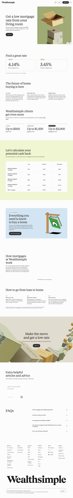


### Section Clips (screens/sections/)

*Clipped individual sections and components*

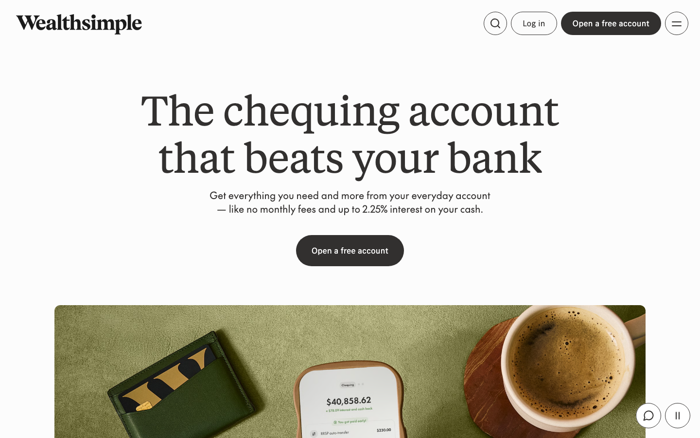

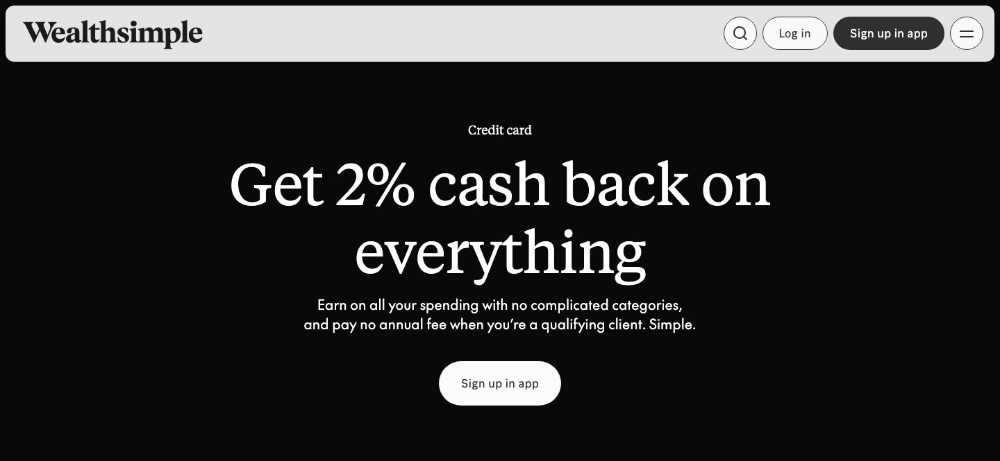

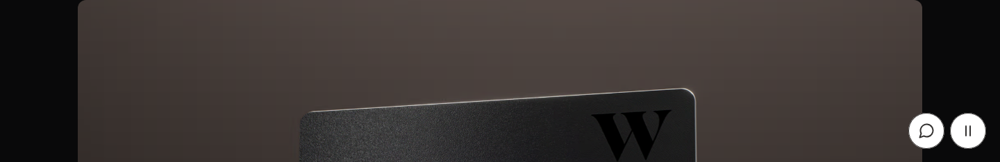

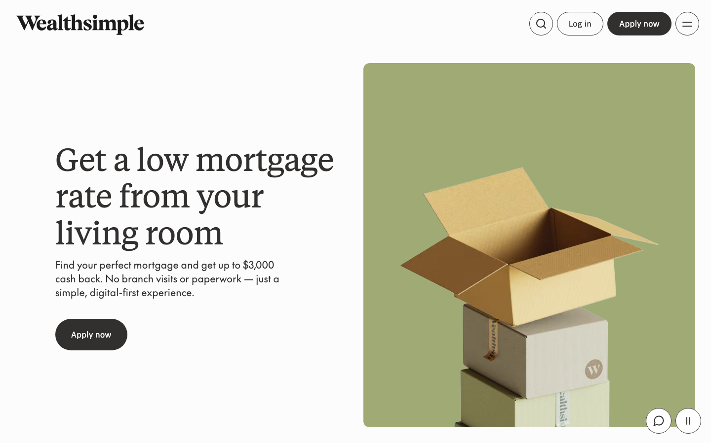


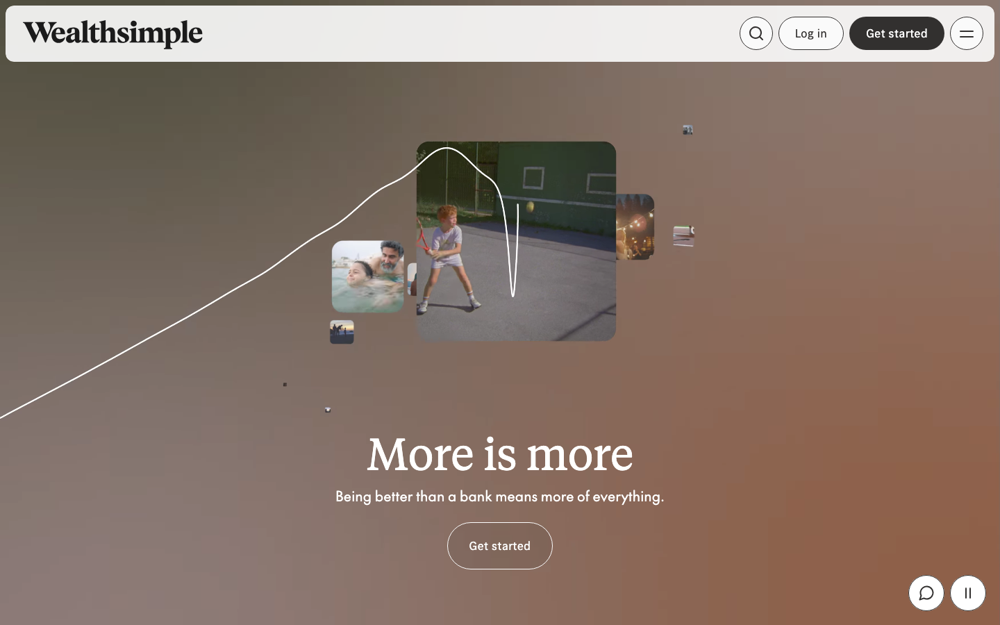

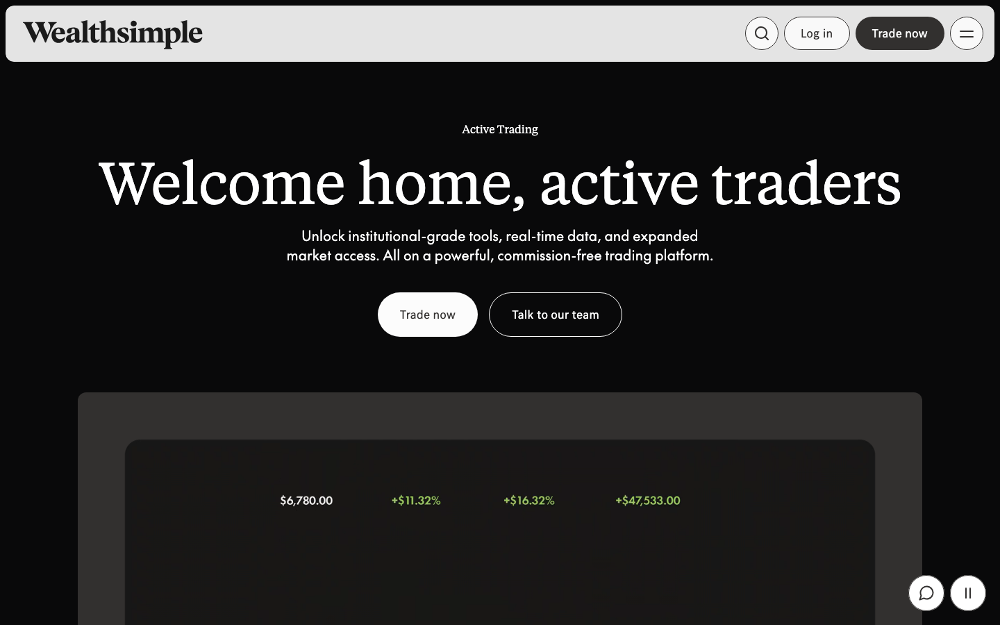

### Interaction States (screens/states/)

*Hover, focus, and active state captures*


### Screenshot Index (screens/INDEX.md)

# Screenshot Index

## Scroll Journey

> Shows the cinematic state at each point of the page

| Scroll | Y Position | File |
|--------|-----------|------|
| 0% | 0px | `screens/scroll/scroll-000.png` |
| 17% | 1605px | `screens/scroll/scroll-017.png` |
| 33% | 3116px | `screens/scroll/scroll-033.png` |
| 50% | 4721px | `screens/scroll/scroll-050.png` |
| 67% | 6326px | `screens/scroll/scroll-067.png` |
| 83% | 7837px | `screens/scroll/scroll-083.png` |
| 100% | 9442px | `screens/scroll/scroll-100.png` |

## Video First Frames

- Video 1 (background): `screens/scroll/video-1-frame.png`

## Pages

| Page | URL | File |
|------|-----|------|
| Wealthsimple | More is more | `https://www.wealthsimple.com/en-ca` | `screens/pages/en-ca.png` |
| High-interest chequing with no monthly fees | Wealthsimple | `https://www.wealthsimple.com/en-ca/chequing` | `screens/pages/en-ca-chequing.png` |
| The credit card with 2% cash back | Wealthsimple | `https://www.wealthsimple.com/en-ca/credit-card` | `screens/pages/en-ca-credit-card.png` |
| Low mortgage rates | Wealthsimple | `https://www.wealthsimple.com/en-ca/mortgages` | `screens/pages/en-ca-mortgages.png` |
| A commission-free platform for active trading | Wealthsimple | `https://www.wealthsimple.com/en-ca/self-directed-investing/active-trading` | `screens/pages/en-ca-self-directed-investing-active-trading.png` |

## Sections

| Page | Section | File |
|------|---------|------|
| en-ca | #1 (section) | `screens/sections/en-ca-section-1.png` |
| en-ca-chequing | #1 (section) | `screens/sections/en-ca-chequing-section-1.png` |
| en-ca-credit-card | #1 (section) | `screens/sections/en-ca-credit-card-section-1.png` |
| en-ca-credit-card | #2 (section) | `screens/sections/en-ca-credit-card-section-2.png` |
| en-ca-mortgages | #1 (section) | `screens/sections/en-ca-mortgages-section-1.png` |
| en-ca-mortgages | #2 (section) | `screens/sections/en-ca-mortgages-section-2.png` |
| en-ca-self-directed-investing-active-trading | #1 (section) | `screens/sections/en-ca-self-directed-investing-active-trading-section-1.png` |

## Homepage Screenshots (screenshots/)


